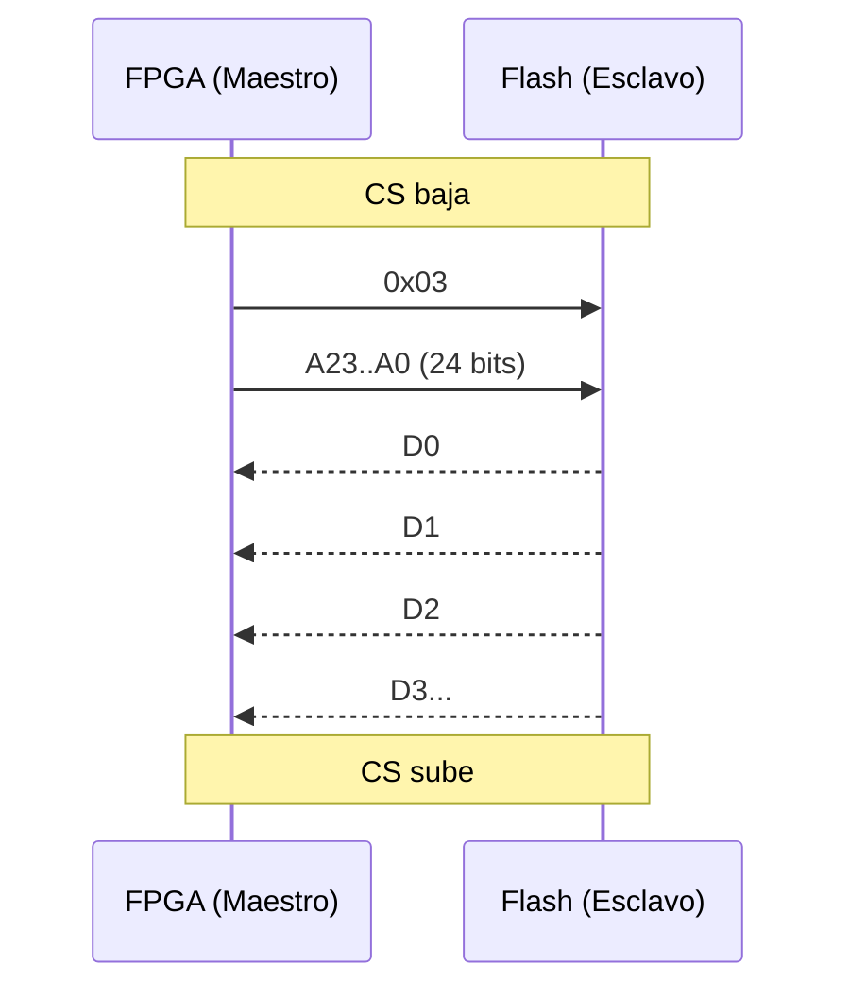
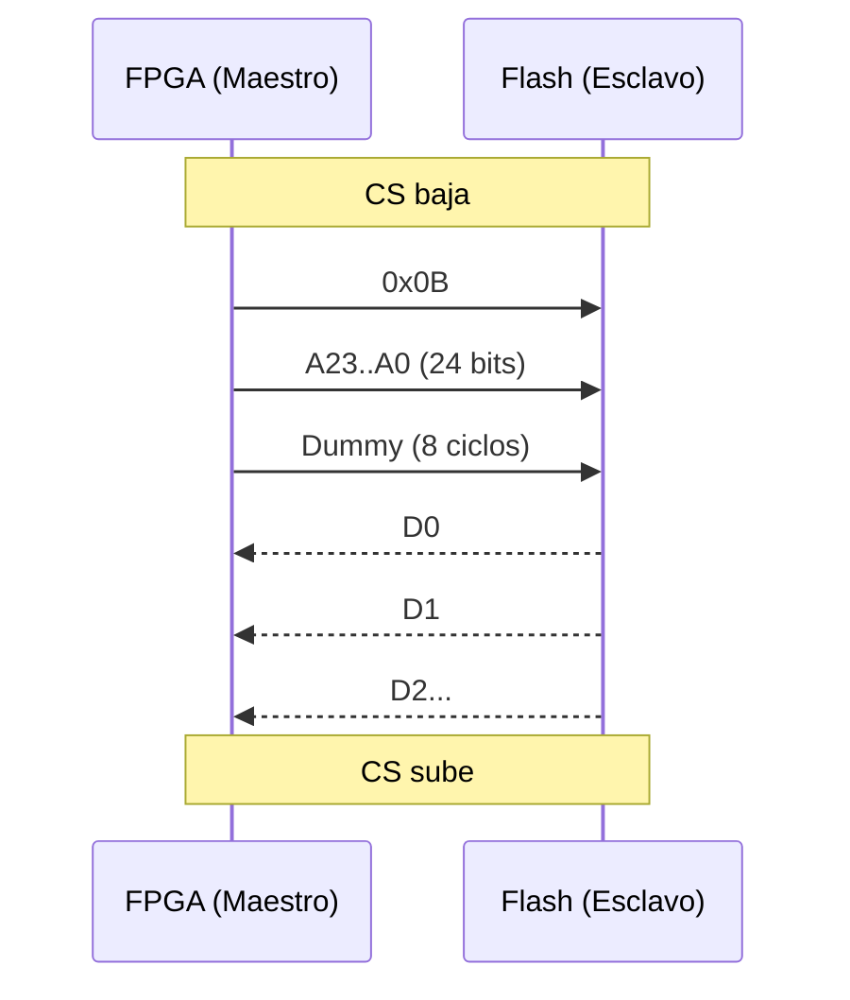

# Protocolo SPI

## 1. Explicación general del protocolo

### 1.1 ¿Qué es SPI?

SPI (**Serial Peripheral Interface**) es un protocolo de comunicación
**sincrónico, serie y full-duplex**. Un dispositivo **maestro** (en
nuestro caso la FPGA) controla a uno o varios **esclavos** (en este
caso, la memoria Flash). El maestro genera el reloj e inicia cada
transacción; el esclavo solo responde.

> **¿Por qué es sincrónico?** Porque una línea de reloj dedicada
> (`SCLK`) viaja junto a los datos. Ambos lados acuerdan que un bit es
> válido *en un flanco específico del reloj*, no después de un tiempo
> fijo. Esto elimina la necesidad de que ambos lados tengan
> osciladores internos iguales, y es la razón por la que SPI es simple
> y confiable a altas frecuencias.

## 1.2 Señales del bus

El protocolo cuenta con cuatro señales principales de conexión:

| Señal       | Nombre completo            | Dirección            | Función                               |
| ----------- | -------------------------- | -------------------- | ------------------------------------- |
| `SCLK`      | Serial Clock               | Maestro → Esclavo    | Reloj generado por el maestro         |
| `MOSI`      | Master Out Slave In        | Maestro → Esclavo    | Datos del maestro hacia el esclavo    |
| `MISO`      | Master In Slave Out        | Esclavo → Maestro    | Datos del esclavo hacia el maestro    |
| `CS` / `SS` | Chip Select / Slave Select | Maestro → Esclavo    | Activo en bajo. Selecciona el esclavo |

`SCLK`, `MOSI` y `CS` son manejadas por la FPGA. `MISO` es manejada
por la Flash. La Flash solo maneja `MISO` mientras `CS` está bajo;
cuando `CS` está alto, la Flash libera `MISO` a alta impedancia (Z)
para que otros esclavos puedan compartir el bus.

## 1.3 Características principales

- **Protocolo sincrónico:** los datos se leen en los flancos del
  reloj. La configuración del flanco de lectura (subida o bajada) y el estado base del
  reloj determinan los cuatro modos de operación del protocolo.
- **Comunicación full-duplex:** MOSI y MISO son líneas independientes; el maestro envía un bit por MOSI al mismo tiempo que recibe un bit por MISO. Cada ciclo de reloj consiste en una transmisión y una recepción simultáneas.
- **Generación del reloj:** SCLK es generado por la FPGA. La memoria Flash no tiene una fuente de reloj interna para el bus.
- **Estabilidad de los datos:** Cuando se muestrea un bit, este debe permanecer estable. En la práctica, esto significa que los datos cambian en un flanco del reloj y se muestrean en el otro, lo que proporciona medio ciclo de reloj completo para que se estabilicen 
- **Velocidad de transmisión:** lLa frecuencia está limitada por el esclavo. La hoja de datos de la memoria Flash define una frecuencia máxima de SCLK. El controlador no debe superarla (véase la tabla de tiempos de la Sección ).

## 1.4 Modos SPI (CPOL / CPHA)

La comunicación SPI puede utilizar cuatro configuraciones
determinadas por **CPOL** (polaridad del reloj: nivel en reposo) y
**CPHA** (fase del reloj: flanco en que se muestrea):

- **CPOL = 0** → `SCLK` en reposo bajo.
- **CPOL = 1** → `SCLK` en reposo alto.
- **CPHA = 0** → muestreo en el flanco **de salida** (primero de cada
  pulso).
- **CPHA = 1** → muestreo en el flanco **de retorno** (segundo de cada
  pulso).

| Modo | CPOL | CPHA | Nivel en reposo | Flanco de muestreo | Flanco de cambio |
| ---- | ---- | ---- | --------------- | ------------------ | ---------------- |
| 0    | 0    | 0    | Bajo            | Subida (salida)    | Bajada (retorno) |
| 1    | 0    | 1    | Bajo            | Bajada (retorno)   | Subida (salida)  |
| 2    | 1    | 0    | Alto            | Bajada (salida)    | Subida (retorno) |
| 3    | 1    | 1    | Alto            | Subida (retorno)   | Bajada (salida)  |

En memorias Flash se utiliza normalmente **Modo 0** o **Modo 3**,
dependiendo de la memoria a trabajar. Este proyecto usa **Modo 0**:
es el más simple de describir y de verificar.

## 1.5 Modo 0 en detalle

En Modo 0, `SCLK` en reposo está **bajo**. El primer flanco de cada
pulso es la **subida**, y es donde se muestrea el dato (flanco de
salida). La **bajada** es el flanco de retorno, donde se permite
cambiar el dato para el siguiente bit.


*Figura 1 — Temporización de transferencia de bits en Modo 0. En cada
flanco de subida el receptor muestrea el bit actual; en cada flanco
de bajada el transmisor prepara el siguiente bit. El medio ciclo
completo entre flancos garantiza que el dato esté estable cuando se
muestrea.*

Tres observaciones que importan para el controlador:

1. **Preparación del primer bit.** El primer bit (`D7` en la figura)
   debe ser válido **antes del primer flanco de subida**. Como `CS`
   baja al inicio de la transacción, el maestro (y el esclavo, en
   `MISO`) tiene hasta el primer flanco de subida para presentar el
   bit. En la práctica el controlador precarga el primer bit en el
   registro de desplazamiento en cuanto `CS` baja.
2. **Muestreo del último bit.** El último bit se muestrea en el
   último flanco de subida. Después de eso, `CS` puede subir; el
   flanco de bajada que normalmente cambiaría el dato no necesita
   ocurrir, porque la transacción está terminando.
3. **`CS` es el delimitador de transacción.** Mientras `CS` está
   bajo, el reloj sigue desplazando bits. Cuando `CS` sube, la
   transacción termina (sujeto a las reglas de frontera de byte que
   se discuten en la Sección 6).

> **Modo 3 es la versión en espejo.** En Modo 3, `SCLK` en reposo está
> alto, el dato cambia en la bajada y se muestrea en la subida. La
> regla de estabilidad de medio ciclo es idéntica; solo se invierten
> los niveles. Como el dispositivo de referencia soporta ambos,
> elegir Modo 0 o Modo 3 es una decisión del controlador, no un
> requisito del protocolo.

## 1.6 Estructura general de la comunicación

Toda transacción con la Flash sigue, de manera general, el siguiente
patrón:

```text
CS baja → [Comando] → [Dirección] → [Dummy, si aplica] → [Datos] → CS sube
```

Los elementos principales de la transacción son:

- **Comando:** 1 byte que indica la operación que se desea realizar.
- **Dirección:** 3 bytes (24 bits, MSB primero) que indican la
  posición de memoria. Solo cuando el comando la requiere.
- **Dummy:** 0 o más bytes de relleno utilizados por algunos
  comandos para dar tiempo interno a la Flash (`FAST_READ` es el
  ejemplo clásico).
- **Datos:** información que se transmite (`MOSI`) o se recibe
  (`MISO`), según el comando. La longitud se define por comando.

La secuencia general de la comunicación es:

1. `CS` baja al inicio de la transacción.
2. El maestro genera el reloj.
3. Se transmite el comando.
4. Se transmite la dirección cuando la operación la requiere.
5. Se transmiten ciclos dummy cuando el comando los requiere.
6. Se transmiten o reciben los datos.
7. `CS` sube al finalizar la transacción.

El trabajo del controlador, a nivel de protocolo, es secuenciar estas
fases correctamente: afirmar `CS`, desplazar el opcode, opcionalmente
desplazar la dirección, opcionalmente insertar ciclos dummy, luego
desplazar datos, y finalmente desafirmar `CS`. Los bytes exactos de
cada fase se especifican en 
[Section ](-flash-command-set); el CSR que los dirige está
en la [Section ](csr-interface-specification).

## 1.7 Estructura interna de la memoria

El diseño del controlador SPI-Flash requiere conocer las características del dispositivo con el que se comunica. La memoria Flash presenta una organización interna definida, una asignación de pines específica y restricciones temporales que el controlador debe respetar para garantizar una comunicación correcta. Estas características determinan aspectos fundamentales del diseño, como el ancho de las direcciones, la longitud de las transacciones, la estrategia de sondeo y la frecuencia máxima de la señal de reloj SCLK.

Entre estas características, la organización interna de la memoria resulta especialmente relevante, ya que permite comprender cómo se interpretan las direcciones enviadas durante las distintas operaciones SPI. En particular, la memoria se organiza en bloques, sectores, páginas y bytes, y cada nivel determina los límites y las restricciones de las operaciones de lectura, programación y borrado. A continuación, se describe esta organización, la descomposición de las direcciones y la distribución de los pines utilizados para establecer la comunicación con la FPGA.

### 1.7.1 Organización de la memoria

La dirección de 24 bits no se interpreta como un puntero plano, sino que el dispositivo la decodifica jerárquicamente en **cuatro niveles**: bloque, sector, página y byte. Cada nivel representa una subdivisión del nivel anterior, como se muestra en la siguiente tabla.

| Nivel | Cantidad | Tamaño | Seleccionado por |
|---|---|---|---|
| Bloque | 256 | 64 KB | `A[23:16]` |
| Sector | 16 por bloque | 4 KB | `A[15:12]` |
| Página | 16 por sector | 256 B | `A[11:8]` |
| Byte | 256 por página | 1 B | `A[7:0]` |


*Figura 1. Organización jerárquica de una memoria Flash SPI NOR de 128 Mbit. Cada nivel subdivide el nivel anterior en unidades de tamaño fijo, lo que permite distribuir los bits de la dirección en los cuatro campos descritos en la subsección 1.7.2.*

La division no es arbitraria: **erase** opera en sectores completos (4 KB) o bloques (64 KB), **program** opera por lo menos en una pagina (256 B), y **read** puede extenderse a través de los límites entre páginas sin necesidad de interrumpir la transferencia. Por tanto, el controlador debe considerar los límites de cada unidad para evitar escrituras que provoquen un retorno al inicio de una página o borrados de regiones mayores que las previstas.

### 1.7.2 Descomposición de direcciones

La dirección de 24 bits `A[23:0]` transmitida mediante SPI constituye una secuencia continua de bits. Sin embargo, la memoria Flash interpreta esta dirección mediante cuatro campos que identifican el bloque, el sector, la página y el desplazamiento del byte dentro de dicha página.


*Figura 2. Descomposición de la dirección de 24 bits en los campos correspondientes al bloque, sector, página y desplazamiento del byte. La combinación de los cuatro niveles permite direccionar un total de 16 777 216 bytes, equivalentes a 16 MiB.*

Esta descomposición tiene tres implicaciones importantes para el diseño del controlador:

1. **Límite de página.** `A[7:0]` identifica el desplazamiento dentro de una página de 256 bytes. Si una operación `PAGE_PROGRAM` intenta escribir más allá del límite de la página actual, la dirección vuelve al inicio de esa misma página y los datos nuevos pueden sobrescribir los datos escritos anteriormente. Por ello, el firmware debe evitar las escrituras que crucen los límites de página, mientras que el controlador de software (*driver*) debe dividirlas en varias operaciones cuando sea necesario.

2. **Límite de sector.** `SECTOR_ERASE (0x20)` borra el sector completo de 4 KB que contiene la dirección indicada, independientemente del desplazamiento dentro de ese sector. En consecuencia, el firmware debe considerar que la granularidad de esta operación es de 4 KB.

3. **Límite de bloque.** `BLOCK_ERASE (0xD8)` borra el bloque completo de 64 KB que contiene la dirección indicada. Por tanto, antes de ejecutar esta operación, el sistema debe asegurarse de que el borrado de toda esa región sea adecuado para la aplicación.

# 2. Conjunto de comandos de la memoria Flash

La [Sección 1](#1-protocolo-spi) explica cómo se transmiten los bits a través de las líneas de comunicación SPI. Esta sección aborda una cuestión diferente: ¿qué secuencia de bytes requiere cada comando y qué información devuelve la memoria Flash?

Para facilitar la comparación entre los comandos, cada uno se describe mediante cuatro elementos:

1. **Propósito:** describe en una frase la función del comando.
2. **Secuencia de comunicación:** presenta los pasos ordenados desde que `CS` pasa a nivel bajo hasta que vuelve a nivel alto.
3. **Tabla de tramas:** especifica qué bytes se transmiten por `MOSI` y cuáles se reciben por `MISO`.
4. **Diagrama de tiempos:** muestra las señales `CS`, `CLK`, `MOSI` y `MISO` de forma conjunta, con los valores de bits correspondientes.

Los diagramas de tiempos son originales de este proyecto. Cada uno incluye una referencia a la figura equivalente de la hoja de datos del fabricante, disponible en `references/spi_flash/`, para facilitar la verificación de las secuencias de comunicación y los tiempos.

## 2.1 Resumen de los comandos

El controlador implementa once comandos, agrupados en tres familias que siguen la organización de la hoja de datos del fabricante de referencia.

| Código de operación | Nombre | Familia | Bytes después del código | Bytes de espera (*dummy*) | Dirección de los datos |
|---|---|---|---|---|---|
| `06h` | WREN | Estado y control | 0 | 0 | — |
| `04h` | WRDI | Estado y control | 0 | 0 | — |
| `05h` | RDSR1 | Estado y control | 0 | 0 | MISO (1 byte, repetible) |
| `35h` | RDSR2 | Estado y control | 0 | 0 | MISO (1 byte, repetible) |
| `01h` | WRSR | Estado y control | 0 | 0 | MOSI (1 byte) |
| `03h` | READ | Lectura | 3 (dirección) | 0 | MISO (N bytes) |
| `0Bh` | FAST_READ | Lectura | 3 (dirección) | 1 | MISO (N bytes) |
| `02h` | PAGE_PROGRAM | Escritura y borrado | 3 (dirección) | 0 | MOSI (1–256 bytes) |
| `20h` | SECTOR_ERASE | Escritura y borrado | 3 (dirección) | 0 | — |
| `D8h` | BLOCK_ERASE | Escritura y borrado | 3 (dirección) | 0 | — |
| `C7h` | CHIP_ERASE | Escritura y borrado | 0 | 0 | — |

**Regla de transmisión MSB primero.** Todos los bytes de todos los comandos se transmiten comenzando por el bit más significativo (*Most Significant Bit*, MSB), en el orden `b7` → `b0`. Esta convención SPI coincide con la hoja de datos del dispositivo.

## 2.2 Comandos de estado y control

Estos comandos gestionan los registros de estado internos de la memoria Flash, que permiten consultar el estado del dispositivo y configurar determinados parámetros de funcionamiento.

### 2.2.1 Write Enable — WREN (06h)

**Propósito.** Establecer en `1` el bit **Write Enable Latch (WEL)** de la memoria Flash. Los comandos `PAGE_PROGRAM`, `SECTOR_ERASE`, `BLOCK_ERASE`, `CHIP_ERASE` y `WRSR` se ignoran si `WEL` no está establecido en `1`. Por tanto, `WREN` es un paso obligatorio antes de ejecutar cualquier operación de escritura o borrado.

**Secuencia de comunicación.**

1. `CS` pasa a nivel bajo.
2. El maestro transmite el byte `06h` por `MOSI`, comenzando por el bit más significativo.
3. `CS` pasa a nivel alto.

Durante toda la transacción, la memoria Flash mantiene la salida `MISO` en alta impedancia. No se devuelve ningún dato.

**Tabla de tramas.**

| Fase | `MOSI` (FPGA → Flash) | `MISO` (Flash → FPGA) |
|---|---|---|
| Código de operación | `06h` | Alta impedancia (sin conducción) |

**Diagrama de tiempos.**


*Figura 1. WREN (`06h`). `CS` delimita la transacción, `CLK` permanece en nivel bajo durante el reposo (Modo 0), `MOSI` transmite `06h` = `0000 0110` y `MISO` permanece en alta impedancia.*

**Referencia en la hoja de datos.** Sección 8.2.1, Figura 5.

**Nota de diseño.** Se trata de una transacción de un solo byte, sin datos de retorno. Desde la interfaz CSR, puede ejecutarse configurando `CMD=WREN`, activando `START` y esperando a que se indique `DONE`. No requiere una FIFO.

### 2.2.2 Write Disable — WRDI (04h)

**Propósito.** Establecer en `0` el bit `WEL`. Después de ejecutar `WRDI`, la memoria Flash rechaza los comandos de escritura y borrado hasta que se emita un nuevo `WREN`. No es necesario ejecutarlo después de una operación `PAGE_PROGRAM` normal, ya que la propia memoria borra `WEL` al completar la operación. Sin embargo, puede utilizarse como medida de seguridad después de una condición de error.

**Secuencia de comunicación.**

1. `CS` pasa a nivel bajo.
2. El maestro transmite `04h` por `MOSI`.
3. `CS` pasa a nivel alto.

**Tabla de tramas.**

| Fase | `MOSI` (FPGA → Flash) | `MISO` (Flash → FPGA) |
|---|---|---|
| Código de operación | `04h` | Alta impedancia (sin conducción) |

**Diagrama de tiempos.**


*Figura 2. WRDI (`04h`). Presenta la misma estructura temporal que WREN, pero utiliza el código de operación `04h` = `0000 0100`.*

**Referencia en la hoja de datos.** Sección 8.2.3, Figura 7.

**Nota de diseño.** Su estructura es idéntica a la de WREN. Puede reutilizarse la máquina de estados finitos (FSM) de transacciones de un solo byte, cambiando únicamente el código de operación.

### 2.2.3 LRead Status Register 1 — RDSR1 (05h)

**Propósito.** Leer el **registro de estado 1** (*Status Register 1*) de 8 bits, que contiene los dos indicadores que necesita consultar el firmware: `BUSY/WIP` (Write in Progres) y `WEL`. Este comando permite determinar si una operación de programación o borrado iniciada previamente ha finalizado.

**Secuencia de comunicación.**

1. `CS` pasa a nivel bajo.
2. El maestro transmite `05h` por `MOSI`.
3. A partir de los siguientes ciclos de reloj, la memoria Flash transmite los bits `S7…S0` por `MISO`.
4. El maestro puede continuar generando ciclos de reloj para recibir repetidamente el byte de estado.
5. `CS` pasa a nivel alto para finalizar la transacción.

**Tabla de tramas.**

| Fase | `MOSI` (FPGA → Flash) | `MISO` (Flash → FPGA) |
|---|---|---|
| Código de operación | `05h` | Alta impedancia (sin conducción) |
| Datos (repetibles) | No relevante | `S7…S0`, seguido de `S7…S0`, etc. |

**Diagrama de tiempos.**


*Figura 3. RDSR1 (`05h`). Después de recibir el código de operación, la memoria Flash transmite el registro de estado por `MISO` durante los ciclos de reloj posteriores.*

**Referencia en la hoja de datos.** Sección 8.2.4, Figura 8a.

**Definición de los bits del registro de estado 1 (bits relevantes).**

| Bit | Nombre | Significado | Representación en el controlador |
|---|---|---|---|
| `S0` | BUSY / WIP | Vale `1` mientras se ejecuta una operación interna de programación o borrado. | `WIP` en `STATUS` |
| `S1` | WEL | Vale `1` cuando se ha ejecutado WREN y el permiso de escritura todavía no se ha consumido. | `WEL` en `STATUS` |
| `S2..S7` | BP/TB/SEC/SRP0 | Configuración de protección contra escritura. | Ignorados |

**Nota de diseño.** RDSR1 es el comando utilizado para el **sondeo** (*polling*). El firmware lo ejecuta repetidamente hasta que `WIP = 0`. La lógica RTL no implementa este bucle: expone transacciones individuales y permite que el firmware gestione las consultas sucesivas.

### 2.2.4 Read Status Register 2 — RDSR2 (35h)

**Propósito.** Leer el **registro de estado 2** (*Status Register 2*) de 8 bits, que contiene los indicadores `QE` (*Quad Enable*), `CMP` (*Complement Protect*), `SRL` (*Status Register Lock*), `LB1..LB3` (bits de bloqueo de la región OTP) y `SUS` (estado de suspensión). En este proyecto, `SUS` y `QE` tienen interés informativo; los demás bits se ignoran. Se incluye RDSR2 para completar el conjunto de comandos y facilitar una posible habilitación futura del modo Quad SPI.

**Secuencia de comunicación.**

1. `CS` pasa a nivel bajo.
2. El maestro transmite `35h` por `MOSI`.
3. A partir de los siguientes ciclos de reloj, la memoria Flash transmite los bits `S15…S8` por `MISO`.
4. El maestro puede continuar generando ciclos de reloj para recibir repetidamente el byte de estado.
5. `CS` pasa a nivel alto para finalizar la transacción.

**Tabla de tramas.**

| Fase | `MOSI` (FPGA → Flash) | `MISO` (Flash → FPGA) |
|---|---|---|
| Código de operación | `35h` | Alta impedancia (sin conducción) |
| Datos (repetibles) | No relevante | `S15…S8`, seguido de `S15…S8`, etc. |

**Diagrama de tiempos.**


*Figura 4. RDSR2 (`35h`). Presenta la misma estructura temporal que RDSR1. Solo cambia el código de operación (`35h` = `0011 0101`) y el byte devuelto corresponde al registro de estado 2.*

**Referencia en la hoja de datos.** Sección 8.2.4, Figura 8a (misma familia de instrucciones que RDSR1).

**Definición de los bits relevantes del registro de estado 2.**

| Bit | Nombre | Significado | Uso en el proyecto |
|---|---|---|---|
| `S9` | QE | Habilitación del modo Quad (debe valer `1` para utilizarlo). | No utilizado; solo se emplea SPI estándar. |
| `S14` | CMP | Protección complementaria. | Ignorado. |
| `S15` | SUS | Estado de suspensión. | Solo lectura; informativo. |

**Nota de diseño.** Utiliza la misma FSM que RDSR1; únicamente cambia el código de operación. El registro `DATA` expone el byte recibido al firmware.

### 2.2.5 Write Status Register — WRSR (01h)

**Propósito.** Escribir el byte del registro de estado 1. En este proyecto, WRSR se incluye para completar el conjunto de comandos y permitir futuras ampliaciones, ya que no se configuran los bits de protección contra escritura. También podría resultar útil en una futura migración a Quad SPI, si fuera necesario habilitar `QE`. Este comando requiere ejecutar previamente `WREN`.

**Secuencia de comunicación.**

1. `CS` pasa a nivel bajo.
2. El maestro transmite `01h` por `MOSI`.
3. El maestro transmite por `MOSI` el nuevo byte de estado.
4. `CS` pasa a nivel alto, una vez completada la transmisión del byte.

**Tabla de tramas.**

| Fase | `MOSI` (FPGA → Flash) | `MISO` (Flash → FPGA) |
|---|---|---|
| Código de operación | `01h` | Alta impedancia (sin conducción) |
| Datos | `S7…S0` | Alta impedancia (sin conducción) |

**Diagrama de tiempos.**


*Figura 5. WRSR (`01h`). Se transmiten dos bytes por `MOSI`: el código de operación `01h`, seguido del byte de estado que se desea escribir. `MISO` permanece en alta impedancia.*

**Referencia en la hoja de datos.** Sección 8.2.5, Figura 9a.

**Nota de diseño.** Su estructura es similar a la de `PAGE_PROGRAM`, pero no transmite bytes de dirección y requiere exactamente un byte de datos. El controlador puede implementarlo como un caso particular de la FSM de escritura, configurando `CMD=WRSR`, `LEN=1` y `ADDR=0`.

## 2.3 Comandos de lectura

Los comandos de lectura permiten recuperar datos de la matriz de memoria Flash. Durante la transferencia, la memoria envía los bytes por `MISO` mientras el maestro continúa generando los ciclos de reloj necesarios. La lectura comienza en la dirección especificada y puede continuar durante varios bytes dentro de una misma transacción, siempre que `CS` permanezca en nivel bajo.

### 2.3.1 Read Data — READ (03h)

**Propósito.** Leer uno o varios bytes de la matriz de memoria a partir de una dirección de 24 bits. El puntero de dirección interno avanza automáticamente, por lo que es posible leer toda la memoria mediante un único comando, siempre que `CS` permanezca en nivel bajo. La frecuencia máxima del reloj es de 50 MHz (véase la [Sección 1.7](#17-estructura-interna-de-la-memoria-flash)).

**Secuencia de comunicación.**

1. `CS` pasa a nivel bajo.
2. El maestro transmite `03h` por `MOSI`.
3. El maestro transmite la dirección de 24 bits `A23…A0`, comenzando por el bit más significativo y utilizando tres bytes.
4. Después de recibir el último bit de la dirección, la memoria Flash comienza a transmitir los datos por `MISO`.
5. El maestro genera los ciclos de reloj necesarios para recibir la cantidad de bytes deseada.
6. `CS` pasa a nivel alto para finalizar la transacción.

**Tabla de tramas.**



| Fase | `MOSI` (FPGA → Flash) | `MISO` (Flash → FPGA) |
|---|---|---|
| Código de operación | `03h` | Alta impedancia |
| Byte de dirección 1 | `A23…A16` | Alta impedancia |
| Byte de dirección 2 | `A15…A8` | Alta impedancia |
| Byte de dirección 3 | `A7…A0` | Alta impedancia |
| Dato 0 | No relevante | `D7…D0` |
| Dato 1 | No relevante | `D7…D0` |
| … | No relevante | … |

**Diagrama de tiempos.**


*Figura 6. READ (03h). Después de transmitir el código de operación de 8 bits y la dirección de 24 bits, la memoria Flash transmite los bytes de datos por `MISO`. El puntero de dirección se incrementa automáticamente después de cada byte.*

**Referencia en la hoja de datos.** Sección 8.2.6, Figura 14.

**Transferencia de Información Ilimitada.** Mientras `CS` esté bajo, la Flash sigue sacando bytes y la dirección interna avanza sola. Al llegar al final, vuelve al inicio (**wrap around**).

> *Cita de clase:* «hay que tener cuidado porque ese se sobrecribe… termina a los 64 espacios y vuelve a escribir el primer».

**Nota de diseño.** El controlador expone los registros `ADDR` (24 bits) y `LEN` (cantidad de bytes) mediante la interfaz CSR. Después de activar `START`, la máquina de estados finitos (FSM) transmite el código de operación y la dirección, y posteriormente almacena los bytes recibidos en la FIFO de recepción (RX FIFO) hasta completar la longitud solicitada. La señal `DONE` se activa cuando finaliza la transacción y se han recibido los bytes solicitados.

### 2.3.2 Fast Read — FAST_READ (0Bh)

**Propósito.** Leer uno o varios bytes de la memoria Flash utilizando una secuencia similar a `READ`, pero incorporando un byte adicional de espera (*dummy byte*) después de la dirección. Este byte proporciona ciclos de reloj adicionales para que la memoria prepare el primer byte de datos y permite utilizar una frecuencia de reloj más elevada, de hasta 133 MHz en el dispositivo de referencia. A 50 MHz, ambos comandos ofrecen un rendimiento efectivo similar; la diferencia resulta relevante a frecuencias superiores.

**Secuencia de comunicación.**

1. `CS` pasa a nivel bajo.
2. El maestro transmite `0Bh` por `MOSI`.
3. El maestro transmite la dirección de 24 bits `A23…A0`.
4. El maestro genera ocho ciclos de reloj adicionales para transmitir un byte de espera. El valor transmitido por `MOSI` no es relevante.
5. La memoria Flash comienza a transmitir los datos por `MISO`.
6. El maestro genera los ciclos de reloj necesarios para recibir la cantidad de bytes deseada.
7. `CS` pasa a nivel alto para finalizar la transacción.

**Tabla de tramas.**

| Fase | `MOSI` (FPGA → Flash) | `MISO` (Flash → FPGA) |
|---|---|---|
| Código de operación | `0Bh` | Alta impedancia |
| Byte de dirección 1 | `A23…A16` | Alta impedancia |
| Byte de dirección 2 | `A15…A8` | Alta impedancia |
| Byte de dirección 3 | `A7…A0` | Alta impedancia |
| Byte de espera | No relevante | No relevante |
| Dato 0 | No relevante | `D7…D0` |
| Dato 1 | No relevante | `D7…D0` |

**Diagrama de tiempos.**


*Figura 7. FAST_READ (0Bh). La secuencia es equivalente a READ, pero incorpora un byte de espera entre la dirección y el primer byte de datos. El diagrama destaca este byte para mostrar su función.*

**Referencia en la hoja de datos.** Sección 8.2.7, Figura 16a.

**Nota de diseño.** Utiliza la misma FSM que `READ`, con un estado adicional de ocho ciclos de reloj para transmitir el byte de espera entre la dirección y los datos. No se necesitan registros CSR adicionales: el campo `CMD` permite seleccionar `READ` o `FAST_READ`, y la FSM gestiona la diferencia entre ambas secuencias.

### 2.3.3 Preguntas frecuentes sobre las operaciones de lectura

<details>
<summary>¿Por qué FAST_READ es más rápido si añade un byte dummy?</summary>

El byte dummy no representa una transferencia de datos útil, sino que proporciona ciclos de reloj adicionales para que la memoria Flash prepare el primer byte de datos.

Durante este intervalo, la memoria puede completar tareas internas como decodificar la dirección, acceder a la celda de memoria y preparar el dato para transmitirlo.

La principal ventaja de `FAST_READ` es que admite una frecuencia máxima de reloj superior a la de `READ`. En el dispositivo de referencia, `READ` admite hasta 50 MHz, mientras que `FAST_READ` puede alcanzar los 133 MHz.

Por ejemplo, para leer 1000 bytes, suponiendo que se utilizan las frecuencias indicadas y que no existen tiempos adicionales entre transacciones:

**READ a 50 MHz:**

$$
T_{READ} = \frac{8 + 24 + 8000}{50 \times 10^6}
\approx 160.6\ \mu s
$$

**FAST_READ a 104 MHz:**

$$
T_{FAST\_READ} = \frac{8 + 24 + 8 + 8000}{104 \times 10^6}
\approx 77.3\ \mu s
$$

En este ejemplo, `FAST_READ` tarda aproximadamente la mitad de tiempo que `READ`, a pesar de incorporar ocho ciclos de reloj adicionales.

**Idea clave:** el byte dummy permite utilizar una frecuencia de reloj más elevada, pero por sí mismo no hace que la lectura sea más rápida.

</details>

<details>
<summary>¿Se pueden leer más de 8 bits con un único comando?</summary>

Sí. Aunque cada byte contiene 8 bits, la memoria Flash puede transmitir varios bytes consecutivos durante una única transacción SPI.

Mientras `CS` permanezca en nivel bajo, el maestro puede seguir generando ciclos de reloj y la memoria continuará transmitiendo datos por `MISO`. La dirección interna se incrementa automáticamente después de cada byte.

Por tanto, no es necesario enviar un comando independiente por cada byte que se quiera leer.

</details>

<details>
<summary>¿Es necesario volver a enviar el comando y la dirección para leer más datos?</summary>

No. El comando y la dirección inicial se transmiten una sola vez al comienzo de la transacción.

Después, el maestro continúa generando ciclos de reloj para recibir los bytes consecutivos. La lectura finaliza cuando `CS` pasa a nivel alto.

Por ejemplo, para leer un valor de 32 bits desde la dirección `0x000100`, se puede utilizar la siguiente secuencia:

```text
CS baja
→ 0x03                    (READ)
→ 00h 01h 00h             (dirección 0x000100)
→ byte0
→ byte1
→ byte2
→ byte3
CS sube
```
Si la memoria almacena el valor con el byte más significativo en la dirección más baja, el valor de 32 bits se reconstruye como:

```
dato = ((uint32_t)byte0 << 24) |
       ((uint32_t)byte1 << 16) |
       ((uint32_t)byte2 <<  8) |
       ((uint32_t)byte3);
```

<details>
<summary>¿Qué comandos deben ejecutarse antes o después de una operación de lectura, escritura o borrado?</summary>

La secuencia de comandos depende del tipo de operación que se quiera realizar:

- **Lectura (`READ` o `FAST_READ`):** no requiere ningún comando previo. Basta con transmitir el código de operación, la dirección inicial y los ciclos de reloj necesarios para recibir los datos.

- **Escritura (`PAGE_PROGRAM`):** requiere ejecutar `WREN` (`06h`) antes de iniciar la operación, para activar el bit `WEL` del registro de estado.

- **Borrado (`SECTOR_ERASE`, `BLOCK_ERASE` o `CHIP_ERASE`):** también requiere ejecutar `WREN` (`06h`) previamente.

- **Comprobación de finalización:** después de una operación de escritura o borrado, se debe consultar el registro de estado mediante `RDSR1` (`05h`) hasta que el bit `WIP` vuelva a `0`. Esto indica que la memoria ha terminado la operación interna y puede aceptar una nueva operación compatible.

En resumen, las operaciones de lectura pueden ejecutarse directamente, mientras que las operaciones de escritura y borrado requieren habilitar previamente la escritura y comprobar posteriormente que la operación ha finalizado.
</details>

<details>
<summary>¿Qué diferencia hay entre SPI e I2S?</summary>

En **I2S**, la frecuencia de muestreo (por ejemplo, 44,1 kHz o 48 kHz) determina el ritmo de reproducción del audio. En **SPI**, la frecuencia de reloj determina principalmente el tiempo de transferencia, sin alterar los datos, siempre que se respeten los límites temporales del dispositivo.

> *Cita de clase:* «En I2S el tiempo importa para la reproducción del audio; en SPI, la velocidad de reloj determina principalmente cuánto tarda en completarse la comunicación».

</details>

## 2.4 Comandos de escritura y borrado

Los comandos de escritura y borrado modifican el contenido de la memoria Flash. Todos requieren una operación `WREN` previa y deben finalizar en un límite de byte completo, es decir, `CS` debe pasar a nivel alto después de transmitir el último byte completo.

Una vez finalizada la transacción, la memoria ejecuta internamente la operación solicitada y establece `WIP = 1` mientras la operación está en curso. Por tanto, el firmware debe consultar periódicamente el registro de estado mediante `RDSR1` hasta que `WIP = 0`, lo que indica que la operación ha terminado.

Las cuatro funcionalidades comparten una estructura de comunicación común: el maestro genera la señal de reloj y establece CS = 0 para seleccionar la memoria e iniciar la transmisión de información. Los datos se envían en el siguiente orden: código de operación, dirección e información, esta última únicamente en el comando de escritura 0x02. Finalmente, la memoria ejecuta la acción indicada por el comando recibido. El funcionamiento detallado de cada una de estas funcionalidades se explica en las secciones posteriores.

### 2.4.1 Page Program — PAGE_PROGRAM (02h)

**Propósito.** Programar o  escribir entre 1 y 256 bytes de datos en una página de memoria, a partir de la dirección especificada. La programación solo permite cambiar bits de `1` a `0`; no es posible cambiar directamente bits de `0` a `1` mediante esta operación. Para sobrescribir datos arbitrarios, es necesario borrar previamente la región correspondiente.  En caso de que los datos enviados hacia el esclavo, lleguen al final de una pagina, los consecuentes se escribiran al inicio de la misma, y no pasaran a la siguiente pagina.

**Secuencia de comunicación.**

1. Ejecutar `WREN` en una transacción independiente.
2. `CS` pasa a nivel bajo.
3. El maestro transmite `02h` por `MOSI`.
4. El maestro transmite la dirección de 24 bits.
5. El maestro transmite entre 1 y 256 bytes de datos por `MOSI`.
6. `CS` pasa a nivel alto después de completar la transmisión de un byte.
7. El firmware consulta `RDSR1` hasta que `WIP = 0`.

**Tabla de tramas.**

| Fase | `MOSI` (FPGA → Flash) | `MISO` (Flash → FPGA) |
|---|---|---|
| Código de operación | `02h` | Alta impedancia |
| Byte de dirección 1 | `A23…A16` | Alta impedancia |
| Byte de dirección 2 | `A15…A8` | Alta impedancia |
| Byte de dirección 3 | `A7…A0` | Alta impedancia |
| Dato 0 | `D7…D0` | Alta impedancia |
| Dato 1 | `D7…D0` | Alta impedancia |
| … hasta el dato 255 | `D7…D0` | Alta impedancia |

**Diagrama de tiempos.**


*Figura 8. PAGE_PROGRAM (02h). La secuencia consta del código de operación, la dirección de 24 bits y entre 1 y 256 bytes de datos transmitidos por `MOSI`. La memoria Flash no transmite datos por `MISO` durante esta operación. `CS` debe pasar a nivel alto en un límite de byte.*

**Referencia en la hoja de datos.** Sección 8.2.13, Figura 29a.

**Nota de diseño.** El controlador expone una FIFO de transmisión (TX FIFO) accesible mediante el registro `DATA`. El firmware introduce los bytes que desea programar y después configura `CMD=PAGE_PROGRAM` y activa `START`. La FSM transmite el código de operación, la dirección y los `LEN` bytes almacenados en la FIFO. Al finalizar, desactiva `CS` y activa `DONE`. El sondeo de `WIP` queda a cargo del firmware.

### 2.4.2 Sector Erase — SECTOR_ERASE (20h)

**Propósito.** Borrar el sector de 4 KB que contiene la dirección especificada. Después del borrado, todos los bytes del sector quedan establecidos en `0xFF`. La operación afecta al sector completo, independientemente de los 12 bits menos significativos de la dirección.

**Secuencia de comunicación.**

1. Ejecutar `WREN`.
2. `CS` pasa a nivel bajo.
3. El maestro transmite `20h` por `MOSI`.
4. El maestro transmite la dirección de 24 bits. El sector seleccionado depende de los bits `A23…A12`.
5. `CS` pasa a nivel alto.
6. El firmware consulta `RDSR1` hasta que `WIP = 0`.

**Tabla de tramas.**

| Fase | `MOSI` (FPGA → Flash) | `MISO` (Flash → FPGA) |
|---|---|---|
| Código de operación | `20h` | Alta impedancia |
| Byte de dirección 1 | `A23…A16` | Alta impedancia |
| Byte de dirección 2 | `A15…A8` | Alta impedancia |
| Byte de dirección 3 | `A7…A0` | Alta impedancia |

**Diagrama de tiempos.**


*Figura 9. SECTOR_ERASE (20h). La secuencia contiene el código de operación y la dirección de 24 bits. La memoria Flash no transmite datos por `MISO` y borra el sector de 4 KB que contiene la dirección especificada.*

**Referencia en la hoja de datos.** Sección 8.2.15, Figura 31a.

**Nota de diseño.** Puede reutilizar la FSM de escritura con `LEN = 0`, ya que no se transmiten bytes de datos después de la dirección. El tiempo típico de borrado es de 45 ms y el máximo es de 400 ms. Por ello, el tiempo de espera implementado en el firmware debe ser de al menos 500 ms.

### 2.4.3 Block Erase — BLOCK_ERASE (D8h)

**Propósito.** Borrar el bloque de 64 KB que contiene la dirección especificada. La operación afecta al bloque completo, independientemente de los 16 bits menos significativos de la dirección.

**Secuencia de comunicación.**

1. Ejecutar `WREN`.
2. `CS` pasa a nivel bajo.
3. El maestro transmite `D8h` por `MOSI`.
4. El maestro transmite la dirección de 24 bits. El bloque seleccionado depende de los bits `A23…A16`.
5. `CS` pasa a nivel alto.
6. El firmware consulta `RDSR1` hasta que `WIP = 0`.

**Tabla de tramas.**

| Fase | `MOSI` (FPGA → Flash) | `MISO` (Flash → FPGA) |
|---|---|---|
| Código de operación | `D8h` | Alta impedancia |
| Byte de dirección 1 | `A23…A16` | Alta impedancia |
| Byte de dirección 2 | `A15…A8` | Alta impedancia |
| Byte de dirección 3 | `A7…A0` | Alta impedancia |

**Diagrama de tiempos.**


*Figura 10. BLOCK_ERASE (D8h). La secuencia contiene el código de operación y la dirección de 24 bits, de la cual solo se utilizan los bits `A23…A16` para seleccionar el bloque. La memoria Flash no transmite datos por `MISO`.*

**Referencia en la hoja de datos.** Sección 8.2.17, Figura 33a.

**Nota de diseño.** Puede reutilizar la FSM de `SECTOR_ERASE`. El tiempo típico de borrado es de 150 ms y el máximo de 2000 ms. Por tanto, el firmware debe implementar un tiempo de espera de al menos 3 s.

### 2.4.4 Chip Erase — CHIP_ERASE (C7h)

**Propósito.** Borrar toda la matriz de memoria Flash. Este comando no requiere una dirección y representa la operación de borrado de mayor duración, con un tiempo máximo de hasta 100 s en el dispositivo de referencia.

**Secuencia de comunicación.**

1. Ejecutar `WREN`.
2. `CS` pasa a nivel bajo.
3. El maestro transmite `C7h` por `MOSI`.
4. `CS` pasa a nivel alto.
5. El firmware consulta `RDSR1` hasta que `WIP = 0`, teniendo en cuenta la larga duración de la operación.

**Tabla de tramas.**

| Fase | `MOSI` (FPGA → Flash) | `MISO` (Flash → FPGA) |
|---|---|---|
| Código de operación | `C7h` | Alta impedancia |

**Diagrama de tiempos.**


*Figura 11. CHIP_ERASE (C7h). Se transmite un único byte por `MOSI`, sin dirección ni datos adicionales. La memoria Flash no transmite datos por `MISO`. El borrado comienza internamente después de que `CS` pasa a nivel alto.*

**Referencia en la hoja de datos.** Sección 8.2.18, Figura 34.

**Nota de diseño.** Puede reutilizarse la estructura de control de `WREN`, adaptándola para gestionar la duración mucho mayor del borrado. Debido a que esta operación elimina todos los datos almacenados, el firmware debe advertir al usuario antes de ejecutarla y aplicar un tiempo de espera adecuado.


### 2.4.5 Uso práctico de los comandos de escritura y borrado

El uso práctico de estos cuatro comandos comparte una estructura general. Antes de ejecutar cualquier operación de escritura o borrado, se debe enviar el comando `0x06` (Write Enable), el cual habilita la memoria para realizar este tipo de operaciones.

Posteriormente, se envía el comando correspondiente a la operación que se desea realizar: `0x02` (Page Program), `0x20` (Sector Erase), `0xD8` (Block Erase) o `0xC7` (Chip Erase).

Una vez iniciada la operación, la memoria necesita un tiempo para completarla. Durante este proceso, se utiliza el comando `0x05` (Read Status Register) para consultar el estado de la memoria. Este comando puede repetirse hasta verificar que la operación haya finalizado. La información del registro de estado es enviada por la memoria hacia el maestro mediante la línea `MISO`. Este proceso se ilustra a continuación.


---

# 5. Diagrama de flujo general del protocolo

Esta sección presenta el **diagrama de flujo general del protocolo SPI para la memoria Flash**, mostrando de manera global la secuencia que sigue una transacción desde la activación de `CS` hasta su finalización.

El diagrama de flujo utilizado para representar esta secuencia se encuentra en los archivos gráficos incluidos en este directorio.


---

# 6. Diagramas internos

Basandonos en lo explicado en este README y considerando la arquitectura propuesta por el profesor para la comunicacion entre el RV32I y la memoria flash, este seria el diagrama de entradas y salidas de su controlador.


# 7. Diagramas de flujo

Basándonos en el diagrama de entradas y salidas, y en las necesidades y limitaciones tanto del RV32I como del protocolo SPI para memorias flash, a continuación se presentan los diagramas de flujo de las acciones disponibles para el RV32I mediante el módulo de control de la memoria flash.

## 7.1 Lectura de información pedida por la CPU

El siguiente diagrama de flujo explica la secuencia de pasos necesarios para realizar una lectura de datos entre 2 direcciones de memoria escogidas por la CPU.


Para ver los registros de consulta de la CPU y una descripción más detallada de las variables del diagrama, vaya [aquí](cores/spi_flash/diagramas/diagrama_flujo_lectura_flash.pdf) o a [aquí](cores/spi_flash/diagramas/diagrama_flujo_lectura_flash.png) (formato png).


## 7.2 Borrado de información pedido por la CPU

El siguiente diagrama de flujo explica la secuencia de pasos necesarios para borrar un sector (4 KB), un bloque (64 KB) o el chip completo. Incluye la habilitación de escritura en la flash (WREN), el envío del comando de borrado y la espera a que la flash termine, con una bandera de error si se agota el tiempo máximo de espera.


Para ver los registros de consulta de la CPU y una descripción más detallada de las variables del diagrama, vaya [aquí](cores/spi_flash/diagramas/diagrama_flujo_borrado_flash.pdf) o a [aquí](cores/spi_flash/diagramas/diagrama_flujo_borrado_flash.png) (formato png).

# 8. Información extra

### Estructura del repo

- `cores/spi_flash/diagramas/` — diagramas de flujo, bloques y protocolo de comunicación

### Equipo

- Jhon Dairon Canizalez Arias
- Edwin Franco Sanchez
- Carlos Alfonso Mahecha Gonzalez


# Esta plantilla no es de mi propiedad.

Toda la documentación y diseño de esta plantilla se encuentra dentro del siguiente repositorio el cual **no me pertenece** y es propiedad del usuario [@cicamargo](https://github.com/cicamargoba).

[Github de digital_UN](https://github.com/cicamargoba/digital_UN/tree/main/2026_1)


