# SPI-Flash Controller Peripheral — FemtoRV32 SoC

**Project:** FPGA Retro Video Game Console  
**Course:** Digital Design I — 2026-2  
**Institution:** Universidad Nacional de Colombia — Sede Bogotá  
**Faculty:** Ingeniería — Departamento de Ingeniería Eléctrica y Electrónica  
**Course upstream repository:** [digital_UN (Prof. Carlos Camargo)](https://github.com/cicamargoba/digital_UN)

## Development Team

- Jhon Dairon Canizalez Arias — [@jcanizalez16](https://github.com/jcanizalez16)
- Edwin Franco Sánchez — [@edfrancos](https://github.com/edfrancos)
- Carlos Alfonso Mahecha Gonzalez — [camahechag](https://github.com/camahechag)

## Contents

- [1. Project Overview](#1-project-overview)
  - [Quick Start](#quick-start)
- [2. Scope](#2-scope)
- [3. Memory-Mapped Interface](#3-memory-mapped-interface)
- [4. Target Flash Device](#4-target-flash-device)
- [5. SPI Protocol](#5-spi-protocol)
- [6. Flash Command Set](#6-flash-command-set)
- [7. Controller Requirements](#7-controller-requirements)
- [8. CSR Interface Specification](#8-csr-interface-specification)
- [9. Operation Flow](#9-operation-flow)
- [10. Repository Structure](#10-repository-structure)
- [11. Planning & Tracking](#11-planning--tracking)
- [12. Development Status](#12-development-status)

---

## 1. Project Overview

This document contains the design, implementation, verification and
integration of the SPI-Flash Controller, a memory-mapped peripheral
that interfaces the FemtoRV32-based SoC with an external SPI NOR Flash
memory.

The controller implements the communication required to access the
Flash device through the Serial Peripheral Interface (SPI) and exposes
this functionality to the processor through a memory-mapped interface.

From the system perspective, the controller is an intermediate layer
between two different interfaces:

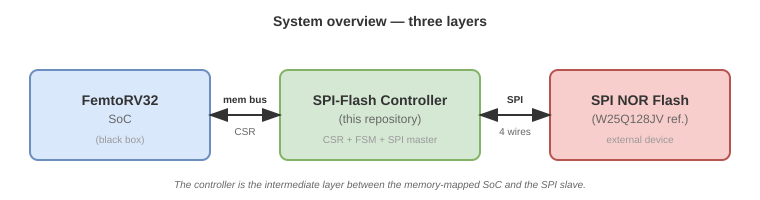

*Figure 1 — The controller sits between the memory-mapped SoC and the
SPI slave.*

The project follows the course methodology — **flowchart → ASM → RTL →
hardware** — and each stage produces the artifact that is the input to
the next one:

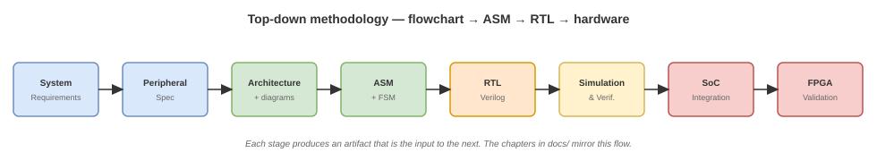

*Figure 2 — Top-down methodology. The six chapters under `docs/` mirror
the eight stages in the diagram.*

The repository therefore documents both the final implementation and
the engineering process used to obtain and verify it.

### Quick Start

```
git clone git@github.com:KUBIX2026/spi_flash_ctrl.git
cd spi_flash_ctrl
cd rtl
make sim      # compile with iverilog and run the testbench
make waves    # open GTKWave with the .gtkw file
```

> Requires `iverilog` and `gtkwave`. The `rtl/` directory is
> self-contained: it does not need the rest of the repository to
> simulate.

---

## 2. Scope

The scope of this project is the complete implementation of the
digital interface between the FemtoRV32-based SoC and the external SPI
Flash memory assigned to the project.

The scope of the design includes:

- specification of the interface between the processor and the
  peripheral;
- specification of the SPI Flash communication protocol required by
  the project;
- definition of the controller architecture;
- design of the control unit and datapath;
- definition of the memory-mapped registers used by the processor;
- implementation of the controller in synthesizable RTL;
- development of a simulation environment for functional verification;
- development of the corresponding firmware interface;
- integration with the SoC;
- validation of the peripheral on the FPGA hardware.

The FemtoRV32 processor is treated as a black-box component. Its
internal implementation is therefore outside the scope of this project;
the controller is designed according to the interfaces and system-level
requirements established by the course project.

The detailed requirements, architectural decisions, register
definitions, SPI transactions, RTL implementation and verification
procedures are developed in the subsequent sections of this
documentation.

---

## 3. Memory-Mapped Interface

| Attribute | Value |
|---|---|
| Base address | `0x420000` |
| Range | `0x420000 – 0x42FFFF` |
| Select (`cs`) | `cs[?]` — index to be confirmed with the integration team |
| Port contract | `d_in, cs, addr, rd, wr, d_out` |
| Data width | 32 bits |
| Clock domain | Single `clk`, async reset `rst` |

The full register map (six registers: `CTRL`, `STATUS`, `ADDR`, `DATA`,
`LEN`, `CFG`) is documented in
[Section 8 — CSR Interface Specification](#8-csr-interface-specification).

---

## 4. Target Flash Device

This section defines **what** the SPI-Flash Controller must do. It is the
input to every later stage (architecture, design, verification,
integration). Everything in this section is **complete** and stable; any
change here is a breaking change that requires coordination with the
firmware and integration teams.

### 1. Why this document exists

The SPI-Flash controller has to talk to a real chip. That chip has an internal
structure, a fixed pinout, and timing constraints that the controller must
respect. Without knowing the target device, it is impossible to decide the
address width, the transaction length, the polling strategy, or the maximum
SCLK frequency.

This section defines the **target device** that the controller is designed
against. It is the input to the command set ([Section 6](#6-flash-command-set)),
the requirements ([Section 7](#7-controller-requirements)), and the CSR
interface ([Section 8](#8-csr-interface-specification)).

### 2. The device class: 128 Mbit SPI NOR Flash

The KUBIX project stores game data (sprites, level data, high-score tables)
in an external SPI NOR Flash. The course does not mandate a specific part
number; it only requires:

| Constraint | Reason |
|---|---|
| SPI-compatible interface (Standard SPI, 4 signals) | Same bus used by the course |
| ≥ 16 MiB of storage | Holds game binary and assets |
| 4 KB sector erase granularity | Allows in-place updates of small blocks |
| Single-supply 3.3 V operation | Matches the FPGA I/O voltage |

These constraints define the **device class**: a **128 Mbit (16 MiB) SPI NOR
Flash with 4 KB sectors**. Any part in this class is compatible with the
controller.

> **Note on the reference device.** This documentation uses the **Winbond
> W25Q128JV** as the reference device because (a) it is a widely available
> JEDEC-standard part, (b) its public datasheet covers all timings needed by
> the controller, and (c) its internal organization (Section 4) matches the
> 16 MiB / 4 KB-sector requirement exactly. If the final hardware uses a
> different part in the same class, only the timing table (Section 7) and
> the JEDEC ID (Section 8) change; the RTL, the CSR interface, and the
> command set remain unchanged.

### 3. Reference device: W25Q128JV

| Parameter | Value |
|---|---|
| Density | 128 Mbit (16 MiB) |
| Organization | 256 blocks × 64 KB; 4096 sectors × 4 KB; 65,536 pages × 256 B |
| Supply voltage | 2.7 V – 3.6 V |
| Max clock frequency | 133 MHz (Fast Read, 3.0–3.6 V) |
| Interface | SPI (Single, Dual, Quad) |
| Programming cycles | 100,000 erase/program cycles |
| Data retention | > 20 years |

### 4. Memory organization

Understanding how the Flash memory is internally divided is essential to
understand the address that is sent in every command. A 24-bit address is
not a flat pointer: it is decoded hierarchically by the device.

The memory is organized into **four nesting levels**:

| Level | Count | Size | Selected by |
|---|---|---|---|
| Block | 256 | 64 KB | `A[23:16]` |
| Sector | 16 per block | 4 KB | `A[15:12]` |
| Page | 16 per sector | 256 B | `A[11:8]` |
| Byte | 256 per page | 1 B | `A[7:0]` |

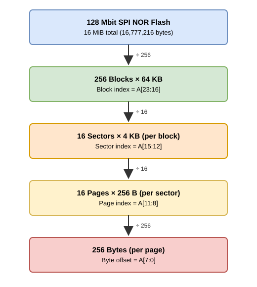

*Figure 1 — Hierarchical organization of a 128 Mbit SPI NOR Flash. Each level
divides the previous one by a fixed power of two, which is why the address
bits split cleanly into the four fields shown in Section 5.*

The division is not arbitrary: **erase** operates on whole sectors (4 KB) or
blocks (64 KB), **program** operates on at most one page (256 B), and **read**
can stream across page boundaries without interruption. The controller must
be aware of these boundaries to avoid wrapping or over-erasing (Section 5).

### 5. Address decomposition

The 24-bit address `A[23:0]` sent over SPI is a single continuous bit stream,
but it is decoded into four fields by the device:

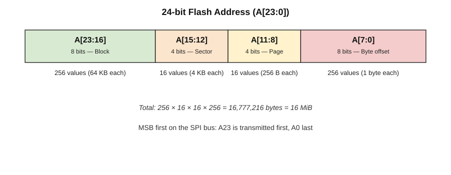

*Figure 2 — The 24-bit Flash address is decoded into block, sector, page and
byte-offset fields. The 256 × 16 × 16 × 256 product gives the total capacity:
16,777,216 bytes = 16 MiB.*

Three consequences matter for the controller:

1. **Page boundary.** `A[7:0]` is the offset inside a 256-byte page. A
   `PAGE_PROGRAM` that crosses a page boundary wraps around to the start of
   the same page, overwriting the data already written. Firmware must never
   issue a write that crosses a page boundary; the driver must split it.
2. **Sector boundary.** `SECTOR_ERASE (0x20)` erases the whole 4 KB sector
   that contains the address, regardless of `A[11:0]`. Firmware must be
   aware that the effective erase granularity is 4 KB.
3. **Block boundary.** `BLOCK_ERASE (0xD8)` erases the whole 64 KB block.

### 6. Pinout and signals

The reference device is available in an 8-pin SOIC-208 package. Only four of
the eight pins are used by Standard SPI:

| Pin | Name | Direction | Function |
|---|---|---|---|
| 1 | `/CS` | FPGA → Flash | Chip Select, active low |
| 2 | `DO` (IO1) | Flash → FPGA | Data Out (MISO) |
| 3 | `/WP` (IO2) | — | Write Protect (tied high in this project) |
| 4 | `GND` | — | Ground |
| 5 | `DI` (IO0) | FPGA → Flash | Data In (MOSI) |
| 6 | `CLK` | FPGA → Flash | Serial Clock (SCLK) |
| 7 | `/HOLD` (IO3) | — | Hold (tied high in this project) |
| 8 | `VCC` | — | 3.3 V supply |


*Figure 3 — Physical connection between the FPGA (SPI master) and the Flash
(SPI slave). Only SCLK, MOSI, MISO and CS carry data; `/WP` and `/HOLD` are
tied to VCC to disable the corresponding features.*

### 7. Timing parameters

These values bound the controller design. They come from the reference
datasheet (AC Electrical Characteristics, §9.6) and are used in the CSR
timeout/watchdog ([Section 8](#8-csr-interface-specification)) and in
verification (see `docs/04_verification.md`).

| Symbol | Parameter | Min | Typ | Max | Unit |
|---|---|---|---|---|---|
| `f_R` | Read clock frequency (03h) | DC | — | 50 | MHz |
| `f_R` (Fast Read) | Fast Read clock frequency (0Bh) | DC | — | 133 | MHz |
| `t_PP` | Page Program time | — | 0.7 | 3 | ms |
| `t_SE` | Sector Erase time (4 KB) | — | 45 | 400 | ms |
| `t_BE` | Block Erase time (64 KB) | — | 150 | 2000 | ms |
| `t_CE` | Chip Erase time | — | 20 | 100 | s |
| `t_SHSL2` | CS deselect time (after erase/program) | 50 | — | — | ns |
| `t_PUW` | Power-up delay before write | 5 | — | — | ms |

> **Design implication.** The maximum erase time (2000 ms for a 64 KB block,
> 100 s for chip erase) is far longer than any reasonable polling timeout.
> The CSR must expose a timeout register, and firmware must implement a
> retry-or-abort policy. This is captured in [Section 7](#7-controller-requirements)
> (RNF-…).

### 8. Device identification

The controller can verify that it is talking to the expected device by
reading the **JEDEC ID** (`9Fh` command, datasheet §8.2.27):

| Byte | Value | Meaning |
|---|---|---|
| Manufacturer ID | `EFh` | Winbond |
| Memory Type | `40h` | SPI NOR, 3.3 V |
| Capacity | `18h` | 128 Mbit |

The ID is fixed per part number; it is documented here so that the
verification plan can include an identity check at startup.

> **Note.** Because the course does not mandate a specific part, the ID
> check is **recommended** in verification but **not required** in
> production firmware. If the final hardware uses a different part, the
> expected ID changes accordingly; the controller itself does not depend on
> the ID value.

### 9. What the controller depends on

This section ties the memory description back to the RTL and CSR design. It
is the traceability anchor for [Section 7](#7-controller-requirements).

| Memory property | Controller decision | Where |
|---|---|---|
| 24-bit address | `ADDR` register is 24 bits wide | [Section 8](#8-csr-interface-specification) |
| 256-byte page | `LEN` register max = 256 | [Section 8](#8-csr-interface-specification) |
| 4 KB sector | `SECTOR_ERASE` granularity | [Section 6](#6-flash-command-set) |
| Status register WIP | Polling loop after program/erase | [Section 8](#8-csr-interface-specification) |
| Max `f_R` = 50 MHz | SCLK divider must reach ≤ 50 MHz | [Section 7](#7-controller-requirements) RNF-… |
| Erase time up to 2 s | Timeout register required | [Section 7](#7-controller-requirements) RNF-… |
| JEDEC ID `EFh 40h 18h` | Optional startup identity check | `docs/04_verification.md` |

---

## 5. SPI Protocol

### 1. Why this document exists

Before the controller can talk to the Flash, we need to agree on *how* the
conversation happens: which wires carry what, who drives them, and when
a bit is considered valid. This section defines the **SPI protocol** as
applied in this project. It answers *how* two devices exchange bits; it
does **not** answer *what* each command means (that is in
[Section 6](#6-flash-command-set)) or *how* the chip is organized
internally (that is in [Section 4](#4-target-flash-device)).

### 2. What SPI is

**SPI** (**Serial Peripheral Interface**) is a **synchronous, serial,
full-duplex** communication protocol. One device acts as **master** (in our
case, the FPGA) and controls one or more **slaves** (in our case, the Flash
memory). The master generates the clock; the slave never does. The master
initiates every transaction; the slave only responds.

> **Why synchronous?** Because a dedicated clock line (`SCLK`) travels
> alongside the data. Both sides agree that a bit is valid *at a specific
> clock edge*, not after a fixed time. This removes the need for both
> sides to have matched internal oscillators, which is why SPI is simple
> and reliable at high frequencies.

### 3. The four bus signals

| Signal | Full name | Direction | Function |
|---|---|---|---|
| `SCLK` | Serial Clock | Master → Slave | Clock generated by the master. |
| `MOSI` | Master Out Slave In | Master → Slave | Data from master to slave. |
| `MISO` | Master In Slave Out | Slave → Master | Data from slave to master. |
| `CS` (or `SS`) | Chip Select / Slave Select | Master → Slave | Active low. Selects the slave. |

`SCLK`, `MOSI`, and `CS` are driven by the FPGA. `MISO` is driven by the
Flash. The Flash only drives `MISO` while `CS` is low; when `CS` is high,
the Flash releases `MISO` to high-impedance (Z) so other slaves could share
the bus.

### 4. Key characteristics

- **Synchronous.** Data is sampled on a specific clock edge. The choice
  of which edge (rising or falling) and the clock's idle level define the
  SPI mode (Section 5).
- **Full-duplex.** `MOSI` and `MISO` are independent wires; the master
  sends a bit on `MOSI` *at the same time* it receives a bit on `MISO`.
  Every clock cycle is a simultaneous transmit-and-receive.
- **Master-generated clock.** `SCLK` is produced by the FPGA. The Flash
  has no internal clock source for the bus.
- **Data stability rule.** When a bit is sampled, it must be stable. In
  practice this means *data changes on one clock edge and is sampled on
  the other*, giving a full half-cycle of settling time (Section 6).
- **Frequency is bounded by the slave.** The Flash datasheet defines a
  maximum `SCLK` frequency (50 MHz for `READ`, 133 MHz for `FAST_READ`).
  The controller must not exceed it (see timing table in
  [Section 4](#4-target-flash-device)).

### 5. SPI modes: CPOL and CPHA

Two parameters define the clock behavior:

- **CPOL** (Clock Polarity): the idle level of `SCLK`.
  - `CPOL = 0` → idle low.
  - `CPOL = 1` → idle high.
- **CPHA** (Clock Phase): which edge samples the data.
  - `CPHA = 0` → sample on the **leading** edge (first edge of each pulse).
  - `CPHA = 1` → sample on the **trailing** edge (second edge of each pulse).

This yields four modes:

| Mode | CPOL | CPHA | Idle level | Sample edge | Change edge |
|---|---|---|---|---|---|
| 0 | 0 | 0 | Low | Rising (leading) | Falling (trailing) |
| 1 | 0 | 1 | Low | Falling (trailing) | Rising (leading) |
| 2 | 1 | 0 | High | Falling (leading) | Rising (trailing) |
| 3 | 1 | 1 | High | Rising (trailing) | Falling (leading) |

Flash memories typically use **Mode 0** or **Mode 3**. This project uses
**Mode 0**. The reference device (W25Q128JV) supports both; the controller
selects Mode 0 because it is the simplest to describe and to verify.

### 6. Mode 0 in detail

In Mode 0, `SCLK` idles **low**. The first edge of each clock pulse is the
**rising edge**, and it is the edge where data is sampled (this is the
*leading edge*). The **falling edge** is the *trailing edge*, where the
data is allowed to change for the next bit.

The figure below shows four bits being transferred in Mode 0. The red
dashed lines mark the **sample points** (rising edges). The green solid
lines mark the **change points** (falling edges).


*Figure 1 — Mode 0 bit-transfer timing. On each rising edge the receiver
samples the current bit; on each falling edge the transmitter sets up the
next bit. The full half-cycle between edges guarantees that the data is
stable when it is sampled.*

Three observations that matter for the controller:

1. **First bit setup.** The first bit (`D7` in the figure) must be valid
   **before the first rising edge**. Since `CS` goes low at the start of
   the transaction, the master (and the slave, on `MISO`) has until the
   first rising edge to present the bit. In practice the controller
   preloads the first bit into the shift register as soon as `CS` falls.
2. **Last bit sampling.** The last bit is sampled on the last rising edge.
   After that, `CS` may go high; the falling edge that would normally
   change the data does not need to occur, because the transaction is
   ending.
3. **`CS` is the transaction delimiter.** While `CS` is low, the clock
   keeps shifting bits. When `CS` goes high, the transaction is over
   (subject to byte-boundary rules discussed in
   [Section 6](#6-flash-command-set)).

> **Mode 3 is the mirrored version.** In Mode 3, `SCLK` idles high, the
> data changes on the falling edge, and it is sampled on the rising edge.
> The half-cycle stability rule is identical; only the levels are
> inverted. Because the reference device supports both, choosing Mode 0
> or Mode 3 is a controller decision, not a protocol requirement.

### 7. The transaction template

Every Flash command follows the same envelope, even though the interior
differs per command:

```
CS low  →  [Opcode]  →  [Address]  →  [Dummy]  →  [Data]  →  CS high
```

- **Opcode** — 1 byte that selects the operation.
- **Address** — 3 bytes (24 bits, MSB first), only when the command needs it.
- **Dummy** — 0 or more bytes of padding, only for commands that need
  internal setup time (`FAST_READ` is the classic example).
- **Data** — bytes transmitted (`MOSI`) or received (`MISO`), depending on
  the command. Length is defined per command.

The controller's job, at the protocol level, is to sequence these phases
correctly: assert `CS`, shift the opcode, optionally shift the address,
optionally insert dummy cycles, then shift data, then deassert `CS`. The
exact bytes for each phase are specified in
[Section 6](#6-flash-command-set); the CSR that drives them is in
[Section 8](#8-csr-interface-specification).

### 8. Physical connection

Four wires carry the protocol; two more provide power and ground. In
Standard SPI, only four of the Flash's eight SOIC-8 pins are used for
data:


*Figure 2 — Physical connection between the FPGA (master) and the Flash
(slave). `MOSI`, `SCLK`, and `CS` are driven by the FPGA; `MISO` is driven
by the Flash. Power (3.3 V) and ground are shared. The `/WP` and `/HOLD`
pins of the Flash are tied high in this project to disable write-protect
and hold features.*

| FPGA signal | FPGA direction | Flash pin | Flash pin number |
|---|---|---|---|
| `SCLK` | Output | `CLK` | 6 |
| `MOSI` | Output | `DI` (IO0) | 5 |
| `MISO` | Input | `DO` (IO1) | 2 |
| `CS` | Output | `/CS` | 1 |

### 9. Design intuition: frequency vs. correctness

Unlike protocols that carry sampled signals (for example I2S, where the
sample rate must match exactly or the audio is distorted), **SPI
tolerates any clock frequency** as long as the maximum of the slave is
respected. The bits arrive at a different *rate*, but each bit is
correct regardless of how fast or slow the clock runs.

The implication for the controller is that **`SCLK` speed is a performance
parameter, not a correctness parameter**. Slower means a longer
transaction, but the same bytes. This is why the CSR exposes a
**`CLK_DIV` register** ([Section 8](#8-csr-interface-specification)) that
lets firmware trade speed for safety margin during bring-up.

### 10. What the controller must implement

Pulling together everything above, the controller must:

1. Generate `SCLK` in Mode 0 with a programmable divider.
2. Drive `CS` low at the start of a transaction and high at the end,
   respecting the byte-boundary rule for writes.
3. Shift out `MOSI` bits and shift in `MISO` bits on the correct edges.
4. Sequence the phases according to the opcode being executed.
5. Expose the whole transaction through the CSR so firmware can request
   it and read its result.

The **`SCLK` frequency**, the **exact opcode sequences**, and the **CSR
layout** are the subject of the remaining sections. This section has
established only the *vocabulary*: signals, modes, and the transaction
template.

---

## 6. Flash Command Set

### 1. Why this document exists

The [SPI protocol section](#5-spi-protocol) explains *how* bits travel on
the wire. This section answers a different question: *what sequence of
bytes does each command require, and what does the Flash send back?*

Each command is described with the same four elements so that a reader can
compare them side-by-side:

1. **Purpose** — what the command does, in one sentence.
2. **Wire sequence** — numbered steps from `CS` low to `CS` high.
3. **Frame table** — which bytes travel on `MOSI` and which on `MISO`.
4. **Waveform** — an engineering figure showing `CS`, `CLK`, `MOSI` and
   `MISO` together, with the actual bit values annotated.

The waveform figures are original to this project. Each one also cites the
equivalent figure in the reference datasheet
(`references/spi_flash/`) so the reader can cross-check against the
manufacturer's timing.

### 2. Command summary

The controller implements eleven commands, grouped into three families
that mirror the datasheet's own organization.

| Opcode | Name | Family | Bytes after opcode | Dummy | Data direction |
|---|---|---|---|---|---|
| `06h` | WREN | State / control | 0 | 0 | — |
| `04h` | WRDI | State / control | 0 | 0 | — |
| `05h` | RDSR1 | State / control | 0 | 0 | MISO (1 byte, repeats) |
| `35h` | RDSR2 | State / control | 0 | 0 | MISO (1 byte, repeats) |
| `01h` | WRSR | State / control | 0 | 0 | MOSI (1 byte) |
| `03h` | READ | Read | 3 (address) | 0 | MISO (N bytes) |
| `0Bh` | FAST_READ | Read | 3 (address) | 1 | MISO (N bytes) |
| `02h` | PAGE_PROGRAM | Write / erase | 3 (address) | 0 | MOSI (1–256 bytes) |
| `20h` | SECTOR_ERASE | Write / erase | 3 (address) | 0 | — |
| `D8h` | BLOCK_ERASE | Write / erase | 3 (address) | 0 | — |
| `C7h` | CHIP_ERASE | Write / erase | 0 | 0 | — |

**MSB-first rule.** Every byte in every command is shifted with the most
significant bit first (`b7` → `b0`). This is a JEDEC SPI convention and
matches the datasheet, §8.1.

### 3. State and control commands

These commands manage the 8-bit **status register** inside the Flash,
which reports device state and holds configuration bits.

#### 3.1 Write Enable — WREN (06h)

**Purpose.** Set the **Write Enable Latch (WEL)** bit inside the Flash to
`1`. Any subsequent `PAGE_PROGRAM`, `SECTOR_ERASE`, `BLOCK_ERASE`,
`CHIP_ERASE` or `WRSR` will be ignored unless `WEL = 1`. WREN is therefore
the mandatory first step of every write or erase sequence.

**Wire sequence.**

1. `CS` goes low.
2. Master shifts the byte `06h` on `MOSI` (MSB first).
3. `CS` goes high.

The Flash drives `MISO` to high-impedance during the whole command; nothing
is returned.

**Frame table.**

| Phase | `MOSI` (FPGA → Flash) | `MISO` (Flash → FPGA) |
|---|---|---|
| Opcode | `06h` | High-Z (not driven) |

**Waveform.**


*Figure 1 — WREN (06h). `CS` frames the transaction, `CLK` idles low
(Mode 0), `MOSI` carries `06h` = `0000 0110`, and `MISO` is high-Z.*

**Datasheet reference.** §8.2.1, Figure 5.

**Design note.** Single-byte transaction, no return data. The CSR can
treat it as "set `CMD=WREN`, set `START`, wait for `DONE`". No FIFO.

#### 3.2 Write Disable — WRDI (04h)

**Purpose.** Clear the WEL bit to `0`. After a WRDI, the Flash rejects any
write or erase command until the next WREN. Not required after a normal
`PAGE_PROGRAM` (the Flash clears WEL itself), but useful as a safety step
after an error path.

**Wire sequence.**

1. `CS` goes low.
2. Master shifts `04h` on `MOSI`.
3. `CS` goes high.

**Frame table.**

| Phase | `MOSI` (FPGA → Flash) | `MISO` (Flash → FPGA) |
|---|---|---|
| Opcode | `04h` | High-Z (not driven) |

**Waveform.**


*Figure 2 — WRDI (04h). Identical envelope to WREN; opcode `04h` =
`0000 0100`.*

**Datasheet reference.** §8.2.3, Figure 7.

**Design note.** Same structure as WREN. Reuses the single-byte
transaction FSM with a different opcode.

#### 3.3 Read Status Register 1 — RDSR1 (05h)

**Purpose.** Read the 8-bit **Status Register 1**, which contains the two
bits the firmware needs to wait on: **BUSY/WIP** and **WEL**. This is the
only way for the master to know whether a previously started program or
erase has finished.

**Wire sequence.**

1. `CS` goes low.
2. Master shifts `05h` on `MOSI`.
3. Flash drives `MISO` with `S7…S0` from the next clock edge onward.
4. Master can keep clocking to receive the same byte repeatedly.
5. `CS` goes high to end the transaction.

**Frame table.**

| Phase | `MOSI` (FPGA → Flash) | `MISO` (Flash → FPGA) |
|---|---|---|
| Opcode | `05h` | High-Z (not driven) |
| Data (repeatable) | Don't care | `S7…S0`, then `S7…S0`, … |

**Waveform.**


*Figure 3 — RDSR1 (05h). After the opcode, the Flash drives `MISO` on
every clock.*

**Datasheet reference.** §8.2.4, Figure 8a.

**Status Register 1 bit definitions (only relevant bits).**

| Bit | Name | Meaning | Exposed as |
|---|---|---|---|
| `S0` | BUSY / WIP | `1` while an internal program or erase is running. | `WIP` in `STATUS` |
| `S1` | WEL | `1` if WREN has been issued and not yet consumed. | `WEL` in `STATUS` |
| `S2..S7` | BP/TB/SEC/SRP0 | Write-protection configuration | Ignored |

**Design note.** RDSR1 is the **polling command**. Firmware issues it
in a loop until `WIP = 0`. The RTL does not loop; it exposes one-shot
transactions and lets firmware drive the loop.

#### 3.4 Read Status Register 2 — RDSR2 (35h)

**Purpose.** Read the 8-bit **Status Register 2**, which contains the
`QE` (Quad Enable), `CMP` (Complement Protect), `SRL` (Status Register
Lock), `LB1..LB3` (OTP lock bits), and `SUS` (Suspend status) bits.
In this project only `SUS` and `QE` are informational; the rest is
ignored. RDSR2 is included for completeness and for future Quad mode
enablement.

**Wire sequence.**

1. `CS` goes low.
2. Master shifts `35h` on `MOSI`.
3. Flash drives `MISO` with `S15…S8` from the next clock edge onward.
4. Master can keep clocking to receive the same byte repeatedly.
5. `CS` goes high.

**Frame table.**

| Phase | `MOSI` (FPGA → Flash) | `MISO` (Flash → FPGA) |
|---|---|---|
| Opcode | `35h` | High-Z (not driven) |
| Data (repeatable) | Don't care | `S15…S8`, then `S15…S8`, … |

**Waveform.**


*Figure 4 — RDSR2 (35h). Identical envelope to RDSR1; only the opcode
byte changes (`35h` = `0011 0101`) and the byte returned is Status
Register 2.*

**Datasheet reference.** §8.2.4, Figure 8a (same instruction family as
RDSR1).

**Status Register 2 bit definitions (relevant bits).**

| Bit | Name | Meaning | Used |
|---|---|---|---|
| `S9` | QE | Quad Enable (must be 1 for Quad mode) | Not used (Standard SPI only) |
| `S14` | CMP | Complement Protect | Ignored |
| `S15` | SUS | Suspend status | Read-only, informational |

**Design note.** Same FSM as RDSR1; only the opcode byte differs. The
`DATA` register exposes the returned byte to firmware.

#### 3.5 Write Status Register — WRSR (01h)

**Purpose.** Write the 8-bit Status Register 1. Used in this project only
for **`WEL`-protected writes of protection bits** — which the project
does not configure — so WRSR is included for completeness and for future
use (e.g., enabling `QE` if the design ever migrates to Quad SPI).
WRSR requires a preceding `WREN`.

**Wire sequence.**

1. `CS` goes low.
2. Master shifts `01h` on `MOSI`.
3. Master shifts the new status byte on `MOSI`.
4. `CS` goes high (must be on a full byte boundary).

**Frame table.**

| Phase | `MOSI` (FPGA → Flash) | `MISO` (Flash → FPGA) |
|---|---|---|
| Opcode | `01h` | High-Z (not driven) |
| Data | `S7…S0` | High-Z (not driven) |

**Waveform.**


*Figure 5 — WRSR (01h). Two bytes on `MOSI`: opcode `01h` followed by the
status byte to be written. `MISO` remains high-Z.*

**Datasheet reference.** §8.2.5, Figure 9a.

**Design note.** Same FSM as `PAGE_PROGRAM` but with zero address bytes
and exactly one data byte. The controller can implement it as a
degenerate case of the write FSM: `CMD=WRSR`, `LEN=1`, `ADDR=0`.

### 4. Read commands

Read commands retrieve data from the memory array. The Flash returns the
bytes on `MISO` while the master continues to clock.

#### 4.1 Read Data — READ (03h)

**Purpose.** Read one or more bytes from the memory array starting at a
24-bit address. The internal address pointer advances automatically, so
the whole memory can be read with one command as long as `CS` stays low.
Maximum clock frequency: 50 MHz (see [Section 4](#4-target-flash-device)).

**Wire sequence.**

1. `CS` goes low.
2. Master shifts `03h` on `MOSI`.
3. Master shifts the 24-bit address `A23…A0` (MSB first, 3 bytes).
4. Flash begins returning data on `MISO` after the last address bit.
5. Master clocks as many bytes as it needs.
6. `CS` goes high to end the transaction.

**Frame table.**

| Phase | `MOSI` (FPGA → Flash) | `MISO` (Flash → FPGA) |
|---|---|---|
| Opcode | `03h` | High-Z |
| Address byte 1 | `A23…A16` | High-Z |
| Address byte 2 | `A15…A8` | High-Z |
| Address byte 3 | `A7…A0` | High-Z |
| Data 0 | Don't care | `D7…D0` |
| Data 1 | Don't care | `D7…D0` |
| … | Don't care | … |

**Waveform.**

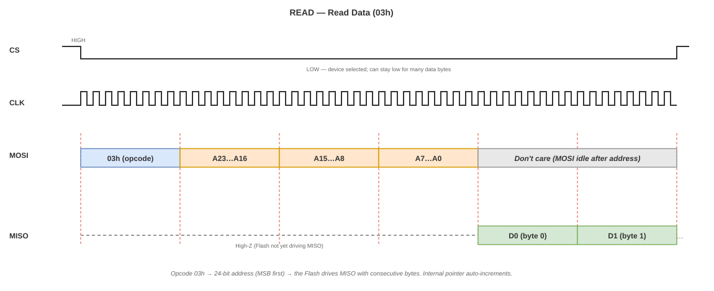

*Figure 6 — READ (03h). After the 8-bit opcode and the 24-bit address,
the Flash drives `MISO` with data bytes. The address auto-increments on
every byte boundary.*

**Datasheet reference.** §8.2.6, Figure 14.

**Design note.** The controller exposes `ADDR` (24 bits) and `LEN`
(number of bytes) in the CSR. After `START`, the FSM shifts opcode +
address, then fills the RX FIFO with `LEN` bytes. `DONE` is asserted
when the FIFO is full.

#### 4.2 Fast Read — FAST_READ (0Bh)

**Purpose.** Same as READ but with an extra dummy byte after the address.
The dummy gives the Flash internal time to prepare the first data byte,
which allows the clock to run faster (up to 133 MHz on the reference
device). At 50 MHz the two commands have the same effective throughput;
the extra byte matters at higher frequencies.

**Wire sequence.**

1. `CS` goes low.
2. Master shifts `0Bh` on `MOSI`.
3. Master shifts the 24-bit address `A23…A0`.
4. Master shifts **one dummy byte** (8 clocks, `MOSI` value is don't-care,
   `MISO` is don't-care).
5. Flash begins returning data on `MISO`.
6. Master clocks as many bytes as it needs.
7. `CS` goes high.

**Frame table.**

| Phase | `MOSI` (FPGA → Flash) | `MISO` (Flash → FPGA) |
|---|---|---|
| Opcode | `0Bh` | High-Z |
| Address byte 1 | `A23…A16` | High-Z |
| Address byte 2 | `A15…A8` | High-Z |
| Address byte 3 | `A7…A0` | High-Z |
| Dummy byte | Don't care | Don't care (usually High-Z or 0) |
| Data 0 | Don't care | `D7…D0` |
| Data 1 | Don't care | `D7…D0` |

**Waveform.**

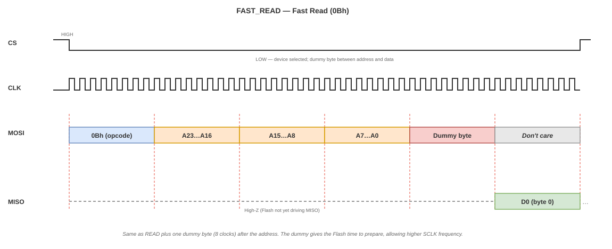

*Figure 7 — FAST_READ (0Bh). Identical to READ plus one dummy byte
between the address and the first data byte. The dummy is highlighted in
the figure to make its role explicit.*

**Datasheet reference.** §8.2.7, Figure 16a.

**Design note.** Same FSM as READ, with an extra 8-clock "dummy" state
between address and data. The CSR needs no new registers; `CMD` selects
`READ` or `FAST_READ` and the FSM handles the difference.

### 5. Write and erase commands

Write and erase commands modify memory. All of them **require a preceding
`WREN`** and all of them **must terminate on a full byte boundary**
(`CS` high after the last full byte). After the command ends, the Flash
internally executes the operation and sets `WIP = 1`; firmware must poll
`RDSR1` until `WIP = 0` before issuing the next command.

#### 5.1 Page Program — PAGE_PROGRAM (02h)

**Purpose.** Program up to 256 bytes (one page) starting at the given
address. Bytes are ANDed with `0xFF` of the currently erased state; the
operation can only flip bits from `1` to `0`. The whole page should be
erased first if a full overwrite is desired.

**Wire sequence.**

1. `WREN` (separate transaction).
2. `CS` goes low.
3. Master shifts `02h` on `MOSI`.
4. Master shifts the 24-bit address.
5. Master shifts 1–256 data bytes on `MOSI`.
6. `CS` goes high (byte boundary).
7. Firmware polls `RDSR1` until `WIP = 0`.

**Frame table.**

| Phase | `MOSI` (FPGA → Flash) | `MISO` (Flash → FPGA) |
|---|---|---|
| Opcode | `02h` | High-Z |
| Address byte 1 | `A23…A16` | High-Z |
| Address byte 2 | `A15…A8` | High-Z |
| Address byte 3 | `A7…A0` | High-Z |
| Data 0 | `D7…D0` | High-Z |
| Data 1 | `D7…D0` | High-Z |
| … up to Data 255 | `D7…D0` | High-Z |

**Waveform.**

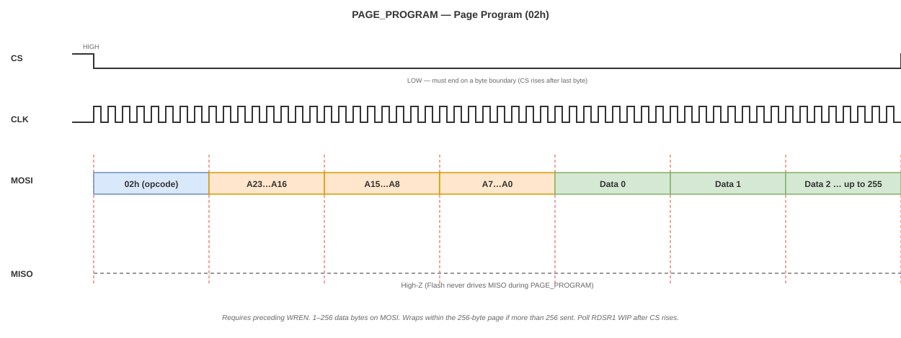

*Figure 8 — PAGE_PROGRAM (02h). Opcode + 24-bit address + 1 to 256 data
bytes on `MOSI`. The Flash never drives `MISO`. `CS` must rise on a
byte boundary.*

**Datasheet reference.** §8.2.13, Figure 29a.

**Design note.** The controller exposes a TX FIFO on the `DATA` register.
Firmware pushes `LEN` bytes, then sets `CMD=PAGE_PROGRAM` and `START`.
The FSM shifts opcode + address + `LEN` bytes from the FIFO, deasserts
`CS`, and asserts `DONE`. Polling `WIP` is firmware's job.

#### 5.2 Sector Erase — SECTOR_ERASE (20h)

**Purpose.** Erase the 4 KB sector containing the given address. Every
byte in the sector becomes `0xFF`. Faster than block erase but erases
the whole sector regardless of the address's low 12 bits.

**Wire sequence.**

1. `WREN`.
2. `CS` goes low.
3. Master shifts `20h` on `MOSI`.
4. Master shifts the 24-bit address (only `A23…A12` matter).
5. `CS` goes high.
6. Firmware polls `RDSR1` until `WIP = 0`.

**Frame table.**

| Phase | `MOSI` (FPGA → Flash) | `MISO` (Flash → FPGA) |
|---|---|---|
| Opcode | `20h` | High-Z |
| Address byte 1 | `A23…A16` | High-Z |
| Address byte 2 | `A15…A8` | High-Z |
| Address byte 3 | `A7…A0` (low 12 bits ignored by Flash) | High-Z |

**Waveform.**

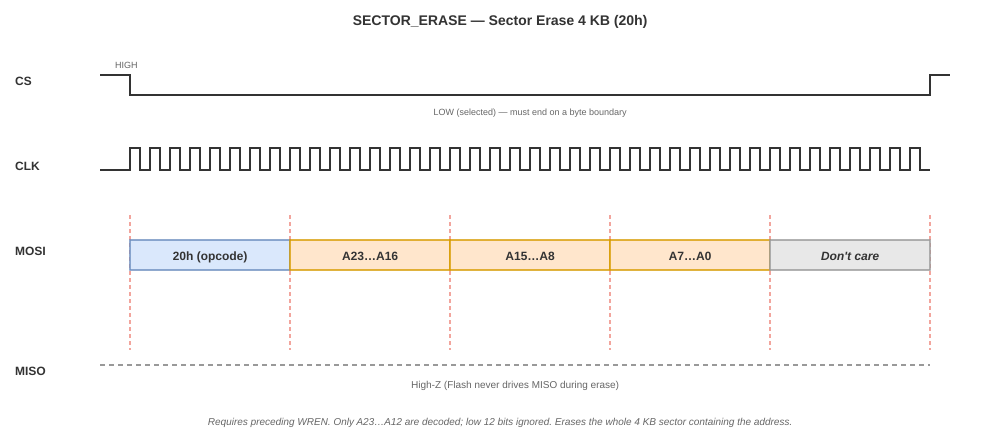

*Figure 9 — SECTOR_ERASE (20h). Opcode + 24-bit address. `MISO` never
driven. The Flash erases the 4 KB sector containing the address.*

**Datasheet reference.** §8.2.15, Figure 31a.

**Design note.** Same FSM as PAGE_PROGRAM but with `LEN = 0` data bytes.
Typical time: 45 ms; maximum 400 ms. Firmware timeout must be ≥ 500 ms.

#### 5.3 Block Erase — BLOCK_ERASE (D8h)

**Purpose.** Erase the 64 KB block containing the given address. Faster
per byte than sector erase but erases the whole block regardless of the
address's low 16 bits.

**Wire sequence.**

1. `WREN`.
2. `CS` goes low.
3. Master shifts `D8h` on `MOSI`.
4. Master shifts the 24-bit address (only `A23…A16` matter).
5. `CS` goes high.
6. Firmware polls `RDSR1` until `WIP = 0`.

**Frame table.**

| Phase | `MOSI` (FPGA → Flash) | `MISO` (Flash → FPGA) |
|---|---|---|
| Opcode | `D8h` | High-Z |
| Address byte 1 | `A23…A16` | High-Z |
| Address byte 2 | `A15…A8` (ignored by Flash) | High-Z |
| Address byte 3 | `A7…A0` (ignored by Flash) | High-Z |

**Waveform.**

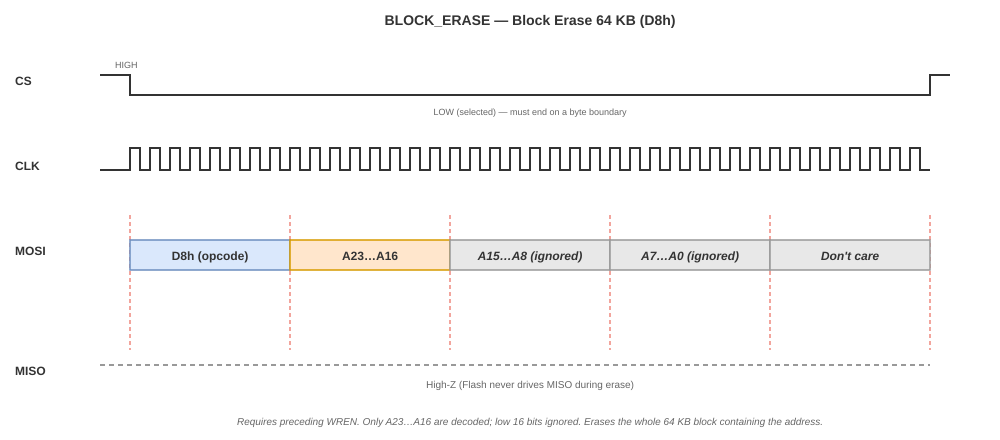

*Figure 10 — BLOCK_ERASE (D8h). Opcode + 24-bit address (only
`A23…A16` are decoded). `MISO` never driven.*

**Datasheet reference.** §8.2.17, Figure 33a.

**Design note.** Same FSM as SECTOR_ERASE. Typical time: 150 ms; maximum
2000 ms. Firmware timeout must be ≥ 3 s.

#### 5.4 Chip Erase — CHIP_ERASE (C7h)

**Purpose.** Erase the whole memory array. No address. The longest
erase operation (up to 100 s on the reference device).

**Wire sequence.**

1. `WREN`.
2. `CS` goes low.
3. Master shifts `C7h` on `MOSI`.
4. `CS` goes high.
5. Firmware polls `RDSR1` until `WIP = 0` (long wait).

**Frame table.**

| Phase | `MOSI` (FPGA → Flash) | `MISO` (Flash → FPGA) |
|---|---|---|
| Opcode | `C7h` | High-Z |

**Waveform.**

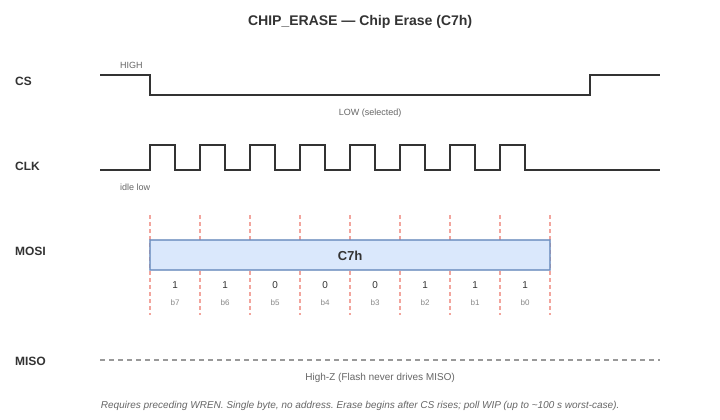

*Figure 11 — CHIP_ERASE (C7h). Single byte on `MOSI`, no address. `MISO`
never driven. The erase happens inside the Flash after `CS` goes high.*

**Datasheet reference.** §8.2.18, Figure 34.

**Design note.** Same FSM as WREN but with a longer timeout. Firmware
should warn the user (this is a destructive operation).

### 6. Cross-cutting design implications

These observations apply to every command above.

- **`CS` frames every transaction.** The Flash accepts commands only when
  `CS` is low. Between transactions `CS` must be high and the bus idle.
- **Byte boundaries.** Read commands can stop on any clock edge. Write
  and erase commands must finish on a **full byte boundary**. The
  controller's FSM must enforce this for `WREN`, `WRSR`, `PAGE_PROGRAM`,
  `SECTOR_ERASE`, `BLOCK_ERASE` and `CHIP_ERASE`.
- **One command per transaction.** The controller issues exactly one
  opcode per `CS` low–high pulse. Composite operations (`WREN` +
  `PAGE_PROGRAM` + polling) are sequences of separate transactions,
  orchestrated by firmware.
- **Polling after write/erase.** `WIP` must be checked via `RDSR1` after
  every program and erase. The RTL does not poll by itself.
- **Page-boundary wrap.** `PAGE_PROGRAM` wraps around to the start of the
  same 256-byte page if more than 256 bytes are sent. Firmware must
  split writes at page boundaries.

### 7. Commands explicitly out of scope

The reference datasheet documents 47 instructions. The controller does
not implement any of the following, and firmware must not issue them:

- Dual/Quad I/O reads (`3Bh`, `BBh`, `6Bh`, `EBh`) — require IO1/IO2/IO3
  wiring and `QE=1` configuration.
- Read Status Register 3 (`15h`), Write Status Register 2/3 (`31h`,
  `11h`) — not used.
- Individual Block/Sector Lock (`36h`, `39h`, `3Dh`, `7Eh`, `98h`) —
  not used.
- Erase/Program Suspend and Resume (`75h`, `7Ah`) — polling model is
  sufficient.
- Power-down (`B9h`) and Release Power-down (`ABh`) — the device stays
  powered during a game session.
- Software Reset (`66h`, `99h`) — not needed.
- Security Register operations (`42h`, `44h`, `48h`) — not used.
- Unique ID (`4Bh`), SFDP (`5Ah`), JEDEC ID (`9Fh`), Manufacturer/Device
  ID (`90h`, `92h`, `94h`) — the controller is designed against the
  reference device; identity checks are optional and can be added in a
  later revision of the verification plan.

> **Rationale.** Every command in this out-of-scope list either uses
> additional pins (Dual/Quad), writes registers the project does not use
> (block locks, SR3), or is a device-management feature not required by
> the KUBIX runtime.

### 8. References

- Winbond **W25Q128JV** datasheet, revision E (23-Nov-2017). Section 8
  (Instructions) and Section 9.6 (AC Electrical Characteristics).
- Local copy of datasheet: `references/spi_flash/`.
- SPI protocol: [Section 5](#5-spi-protocol).
- Target device class: [Section 4](#4-target-flash-device).

---

## 7. Controller Requirements

### 1. Purpose

This section defines **what** the SPI-Flash Controller must do. It sits
between the memory description ([Section 4](#4-target-flash-device)), the
protocol ([Section 5](#5-spi-protocol)) and the command set
([Section 6](#6-flash-command-set)) on one side, and the architecture and
RTL on the other.

Each requirement has a unique identifier (`RF-NN` for functional,
`RNF-NN` for non-functional) and is traceable to:

- the command or feature it comes from (left column of the traceability
  matrix in Section 5),
- the CSR register that implements it ([Section 8](#8-csr-interface-specification)),
- the verification test that proves it (`docs/04_verification.md`).

A requirement that cannot be traced to a test is an unverified requirement
and is not considered met.

### 2. System context

The controller is a memory-mapped peripheral attached to the FemtoRV32
SoC data bus. On one side it exposes the standard course port contract
(`d_in`, `cs`, `addr`, `rd`, `wr`, `d_out`); on the other side it drives
the four SPI wires (`SCLK`, `MOSI`, `MISO`, `CS`) to the external Flash.


*Figure 1 — System context. The controller bridges the FemtoRV32 SoC's
memory bus (`d_in`, `cs`, `addr`, `rd`, `wr`, `d_out`) on the left and
the external SPI NOR Flash (`SCLK`, `MOSI`, `MISO`, `CS`) on the right.
The controller is placed at base `0x420000` with a 64 KB window.*

The controller is located at base address `0x420000` and spans
`0x420000–0x42FFFF` (see the course memory map). It uses exactly one
`cs[i]` line from the address decoder; the index `i` is fixed by the
integration team.

### 3. Functional requirements

#### 3.1 Bus and CSR interface

| ID | Requirement | Source |
|---|---|---|
| **RF-01** | The controller shall expose the course peripheral port contract: `input [31:0] d_in`, `input cs`, `input [N-1:0] addr`, `input rd`, `input wr`, `output reg [31:0] d_out`. | PBL spec |
| **RF-02** | The controller shall respond only when `cs` is asserted, and shall drive `d_out` to zero (or high-Z, per course convention) otherwise. | PBL spec |
| **RF-03** | The controller shall decode word-aligned offsets within its 64 KB window: `0x00` CTRL, `0x04` STATUS, `0x08` ADDR, `0x0C` DATA, `0x10` LEN, `0x14` CFG. | [Section 8](#8-csr-interface-specification) |
| **RF-04** | The controller shall accept write access to CTRL, ADDR, DATA, LEN and CFG, and read access to STATUS and DATA. | [Section 8](#8-csr-interface-specification) |
| **RF-05** | `ADDR` shall hold a 24-bit Flash byte address; bits `[31:24]` shall be ignored. | [Section 4](#4-target-flash-device) §5 |
| **RF-06** | `LEN` shall hold a transfer length from 1 to 256 bytes; a write of 0 or >256 shall be clamped or rejected (implementation-defined). | [Section 4](#4-target-flash-device) §4 |

#### 3.2 SPI master

| ID | Requirement | Source |
|---|---|---|
| **RF-07** | The controller shall generate `SCLK` in SPI Mode 0 (`CPOL=0`, `CPHA=0`): idle low, data sampled on rising edge, data changed on falling edge. | [Section 5](#5-spi-protocol) §6 |
| **RF-08** | The controller shall generate `SCLK` with a programmable divider `CLK_DIV` such that `f_SCLK = f_sys / (2 · (CLK_DIV + 1))`. | [Section 5](#5-spi-protocol) §9 |
| **RF-09** | The controller shall drive `CS` low at the start of every transaction and high at the end, and shall enforce a byte-boundary termination for WREN, WRSR, PAGE_PROGRAM, SECTOR_ERASE, BLOCK_ERASE and CHIP_ERASE. | [Section 6](#6-flash-command-set) §6 |
| **RF-10** | The controller shall shift bytes MSB-first on `MOSI` and shall sample `MISO` on the rising edge of `SCLK`. | [Section 6](#6-flash-command-set) §2 |

#### 3.3 Command execution

| ID | Requirement | Source |
|---|---|---|
| **RF-11** | The controller shall execute the **WREN (06h)** transaction: `CS` low, opcode `06h` on `MOSI`, `CS` high. `MISO` is not driven. | [Section 6](#6-flash-command-set) §3.1 |
| **RF-12** | The controller shall execute the **WRDI (04h)** transaction: `CS` low, opcode `04h`, `CS` high. `MISO` is not driven. | [Section 6](#6-flash-command-set) §3.2 |
| **RF-13** | The controller shall execute **RDSR1 (05h)** and capture the byte returned on `MISO` into the RX FIFO. | [Section 6](#6-flash-command-set) §3.3 |
| **RF-14** | The controller shall execute **RDSR2 (35h)** and capture the byte returned on `MISO` into the RX FIFO. | [Section 6](#6-flash-command-set) §3.4 |
| **RF-15** | The controller shall execute **WRSR (01h)**: `CS` low, opcode `01h`, one data byte from the TX FIFO on `MOSI`, `CS` high. `MISO` is not driven. | [Section 6](#6-flash-command-set) §3.5 |
| **RF-16** | The controller shall execute **READ (03h)**: `CS` low, opcode `03h`, 24-bit address, then `LEN` data bytes received from `MISO` into the RX FIFO, `CS` high. | [Section 6](#6-flash-command-set) §4.1 |
| **RF-17** | The controller shall execute **FAST_READ (0Bh)**: identical to READ plus one dummy byte (8 extra clocks) between the address and the first data byte. | [Section 6](#6-flash-command-set) §4.2 |
| **RF-18** | The controller shall execute **PAGE_PROGRAM (02h)**: `CS` low, opcode `02h`, 24-bit address, `LEN` data bytes from the TX FIFO on `MOSI`, `CS` high. | [Section 6](#6-flash-command-set) §5.1 |
| **RF-19** | The controller shall execute **SECTOR_ERASE (20h)**: `CS` low, opcode `20h`, 24-bit address, `CS` high. `MISO` is not driven. | [Section 6](#6-flash-command-set) §5.2 |
| **RF-20** | The controller shall execute **BLOCK_ERASE (D8h)**: `CS` low, opcode `D8h`, 24-bit address, `CS` high. `MISO` is not driven. | [Section 6](#6-flash-command-set) §5.3 |
| **RF-21** | The controller shall execute **CHIP_ERASE (C7h)**: `CS` low, opcode `C7h`, `CS` high. `MISO` is not driven. | [Section 6](#6-flash-command-set) §5.4 |

#### 3.4 Status reporting

| ID | Requirement | Source |
|---|---|---|
| **RF-22** | The controller shall set `STATUS.BUSY = 1` for the entire duration of a transaction (from `START` to the internal completion, including FIFO drain for reads). | [Section 8](#8-csr-interface-specification) |
| **RF-23** | The controller shall set `STATUS.DONE = 1` when a transaction completes; `DONE` shall be cleared when STATUS is read. | [Section 8](#8-csr-interface-specification) |
| **RF-24** | The controller shall set `STATUS.ERR = 1` if a transaction is aborted (FIFO underrun/overrun, or timeout configured in CFG). | [Section 8](#8-csr-interface-specification) |
| **RF-25** | For each completed RDSR1 transaction, the controller shall mirror the returned status byte's bit 0 into `STATUS.WIP` and bit 1 into `STATUS.WEL`. | [Section 8](#8-csr-interface-specification) |

#### 3.5 Data flow

| ID | Requirement | Source |
|---|---|---|
| **RF-26** | The controller shall provide a TX FIFO into which firmware writes bytes through the `DATA` register for PAGE_PROGRAM and WRSR. | [Section 8](#8-csr-interface-specification) |
| **RF-27** | The controller shall provide an RX FIFO from which firmware reads bytes through the `DATA` register for READ, FAST_READ, RDSR1 and RDSR2. | [Section 8](#8-csr-interface-specification) |
| **RF-28** | Writing to `DATA` when the TX FIFO is full shall be ignored and shall set `STATUS.ERR`. | [Section 8](#8-csr-interface-specification) |
| **RF-29** | Reading from `DATA` when the RX FIFO is empty shall return `0x00000000` and shall set `STATUS.ERR`. | [Section 8](#8-csr-interface-specification) |
| **RF-30** | `LEN` shall bound the number of bytes read from the RX FIFO or written from the TX FIFO per transaction. | [Section 8](#8-csr-interface-specification) |

### 4. Non-functional requirements

| ID | Requirement | Rationale |
|---|---|---|
| **RNF-01** | The design shall be fully synthesizable Verilog-2001 (no SystemVerilog constructs). | Course toolchain |
| **RNF-02** | `SCLK` shall not exceed 50 MHz for READ and 133 MHz for FAST_READ; the divider must allow both. | [Section 4](#4-target-flash-device) §7 |
| **RNF-03** | The design shall use a single clock domain (`clk`) with an asynchronous active-high reset (`rst`). No internal generated clocks except `SCLK`, which is derived synchronously and used only as a SPI output. | PBL spec |
| **RNF-04** | The design shall be verified with `iverilog` and `gtkwave` using a self-checking testbench. | Course toolchain |
| **RNF-05** | The design shall not modify the FemtoRV32 core, the address decoder, or any other peripheral. | PBL spec |
| **RNF-06** | The CSR interface ([Section 8](#8-csr-interface-specification)) shall be finalized before any RTL coding starts. | Method |
| **RNF-07** | The design shall not implement Dual or Quad SPI; only Standard SPI with `MOSI`, `MISO`, `SCLK`, `CS` is required. | [Section 6](#6-flash-command-set) §7 |
| **RNF-08** | All I/O shall be synchronous to `clk`; no combinational paths longer than one register stage between `cs` and `d_out` are allowed. | Timing |
| **RNF-09** | The RTL shall include a per-command testbench that exercises at least one full transaction for each of the 11 commands. | Verification |
| **RNF-10** | The RTL shall be structured as at least two modules: `spi_master` (bit-level shifter) and `spi_flash_ctrl` (CSR + FSM). | Architecture |
| **RNF-11** | The controller shall not exceed 500 LUTs on the target FPGA (to be confirmed after synthesis). | Budget |
| **RNF-12** | The design shall reset to a state where `CS = 1`, `SCLK = 0`, `MOSI = 0` (idle). | Safety |

### 5. Traceability matrix

Each functional requirement traces back to a command or a CSR register and
forward to the verification test that proves it. The verification column
is filled in during `docs/04_verification.md`; the cells that say "TBD" are
placeholders until that document is written.

#### 5.1 Command traceability

| Requirement | Command | Datasheet figure | CSR register(s) used |
|---|---|---|---|
| RF-11 | WREN (06h) | §8.2.1, Fig. 5 | CTRL (`CMD=WREN`), STATUS (`DONE`) |
| RF-12 | WRDI (04h) | §8.2.3, Fig. 7 | CTRL, STATUS |
| RF-13 | RDSR1 (05h) | §8.2.4, Fig. 8a | CTRL, DATA (RX), STATUS (`WIP`, `WEL`, `DONE`) |
| RF-14 | RDSR2 (35h) | §8.2.4, Fig. 8a | CTRL, DATA (RX), STATUS |
| RF-15 | WRSR (01h) | §8.2.5, Fig. 9a | CTRL, DATA (TX), LEN=1, STATUS |
| RF-16 | READ (03h) | §8.2.6, Fig. 14 | CTRL, ADDR, LEN, DATA (RX), STATUS |
| RF-17 | FAST_READ (0Bh) | §8.2.7, Fig. 16a | CTRL, ADDR, LEN, DATA (RX), STATUS |
| RF-18 | PAGE_PROGRAM (02h) | §8.2.13, Fig. 29a | CTRL, ADDR, LEN, DATA (TX), STATUS |
| RF-19 | SECTOR_ERASE (20h) | §8.2.15, Fig. 31a | CTRL, ADDR, STATUS |
| RF-20 | BLOCK_ERASE (D8h) | §8.2.17, Fig. 33a | CTRL, ADDR, STATUS |
| RF-21 | CHIP_ERASE (C7h) | §8.2.18, Fig. 34 | CTRL, STATUS |

#### 5.2 Interface traceability

| Requirement | CSR register | Spec section |
|---|---|---|
| RF-01, RF-02 | (port contract) | PBL spec |
| RF-03 | All registers | [Section 8](#8-csr-interface-specification) §2 |
| RF-04 | All registers | [Section 8](#8-csr-interface-specification) §2 |
| RF-05 | ADDR | [Section 8](#8-csr-interface-specification) §2.3 |
| RF-06 | LEN | [Section 8](#8-csr-interface-specification) §2.5 |
| RF-07, RF-08 | CFG | [Section 8](#8-csr-interface-specification) §2.6 |
| RF-22 … RF-25 | STATUS | [Section 8](#8-csr-interface-specification) §2.2 |
| RF-26 … RF-30 | DATA, LEN | [Section 8](#8-csr-interface-specification) §2.4, §2.5 |

### 6. Acceptance criteria

The specification is accepted when **all** of the following hold:

#### 6.1 Document-level acceptance

- [ ] Every requirement in Sections 3 and 4 has a unique identifier.
- [ ] Every functional requirement appears in the traceability matrix
      (Section 5.1 or 5.2).
- [ ] Every command in [Section 6](#6-flash-command-set) has at least one
      RF that covers it (RF-11 through RF-21).
- [ ] Every CSR register in [Section 8](#8-csr-interface-specification)
      appears in Section 5.2.
- [ ] No functional requirement contradicts [Section 4](#4-target-flash-device)
      or [Section 5](#5-spi-protocol).

#### 6.2 Implementation-level acceptance (for later checkpoints)

These are the criteria the RTL must eventually satisfy; they are listed
here so that the verification plan can be written against them.

- [ ] A testbench exercises each of the 11 commands at least once.
- [ ] A testbench exercises the FIFO full and empty error paths
      (RF-28, RF-29).
- [ ] A testbench exercises the `DONE` clear-on-read behavior (RF-23).
- [ ] A testbench exercises `CLK_DIV` at minimum and maximum values
      (RF-08).
- [ ] Synthesis passes on the target FPGA without warnings (RNF-01).
- [ ] `CS`, `SCLK` and `MOSI` reset to their idle levels (RNF-12).

### 7. Out-of-scope items

The following are deliberately excluded from this version of the
requirements. They may be added in a later revision but are not part of
the current acceptance criteria.

| Item | Reason |
|---|---|
| Dual/Quad SPI modes | Requires IO1/IO2/IO3 wiring and QE configuration |
| Write protection bits (BP, TB, SEC, CMP) | Not used by KUBIX |
| Block/Sector locks | Not used |
| Erase/Program Suspend and Resume | Polling model is sufficient |
| Power-down mode | Device stays powered |
| JEDEC ID check at startup | Optional; can be added in a later revision |
| DMA or burst transfer from the SoC side | The CSRs are enough for firmware-driven transfers |
| Interrupt generation (e.g., IRQ on DONE) | Polling model only |

### 8. References

- Course PBL specification (top-level).
- [Section 4](#4-target-flash-device) — target device.
- [Section 5](#5-spi-protocol) — wire protocol.
- [Section 6](#6-flash-command-set) — per-command frames.
- [Section 8](#8-csr-interface-specification) — memory-mapped register map.
- Winbond W25Q128JV datasheet, revision E.

---

## 8. CSR Interface Specification

### 1. Purpose

This section defines how the processor sees the SPI-Flash Controller:
which 32-bit registers exist, what each bit means, and what sequences
firmware must follow to read, write, or erase.

It is the **contract** between the RTL and the C driver. Once this
section is agreed, neither side changes it without a coordinated
revision (Section 9).

The register map implements the functional requirements defined in
[Section 7](#7-controller-requirements): every RF related to bus access or
status is materialized here as a specific bit.

### 2. Register map overview

The controller occupies 64 KB at base address `0x420000`
(`0x420000–0x42FFFF`) and exposes **six** word-aligned registers. The
rest of the window reads as zero and ignores writes.

| Offset | Name | Access | Width | Purpose |
|---|---|---|---|---|
| `0x00` | `CTRL` | Write | 32 bits | Command selector and start bit |
| `0x04` | `STATUS` | Read | 32 bits | Busy, done, error, WIP, WEL |
| `0x08` | `ADDR` | Write | 32 bits (24 used) | 24-bit Flash address |
| `0x0C` | `DATA` | Read / Write | 32 bits (8 used) | Data FIFO port |
| `0x10` | `LEN` | Write | 32 bits (9 used) | Number of bytes (1–256) |
| `0x14` | `CFG` | Write | 32 bits | Clock divider, SPI mode |

The layout is illustrated in the diagram below, which shows the six
registers occupying the first 24 bytes of the window.

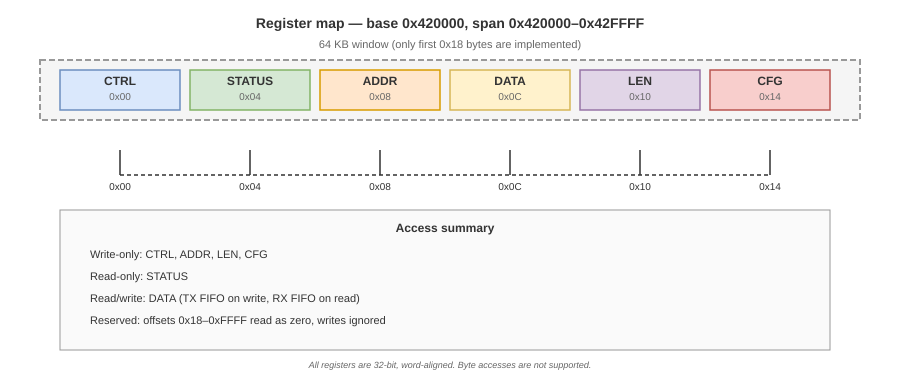

*Figure 1 — Register map of the SPI-Flash Controller at base
`0x420000`. The six registers occupy offsets `0x00` to `0x14`; the rest
of the 64 KB window is reserved.*

### 3. Command encoding

The `CTRL.CMD` field selects one of the eleven supported commands
(see [Section 6](#6-flash-command-set)). The encoding is chosen
to be simple to decode in RTL and simple to remember in C.

| `CMD` value | Mnemonic | Opcode | Command name |
|---|---|---|---|
| `0`  | `READ`         | `03h` | READ |
| `1`  | `FAST_READ`    | `0Bh` | FAST_READ |
| `2`  | `WREN`         | `06h` | WREN |
| `3`  | `WRDI`         | `04h` | WRDI |
| `4`  | `RDSR1`        | `05h` | RDSR1 |
| `5`  | `RDSR2`        | `35h` | RDSR2 |
| `6`  | `WRSR`         | `01h` | WRSR |
| `7`  | `PAGE_PROGRAM` | `02h` | PAGE_PROGRAM |
| `8`  | `SECTOR_ERASE` | `20h` | SECTOR_ERASE |
| `9`  | `BLOCK_ERASE`  | `D8h` | BLOCK_ERASE |
| `10` | `CHIP_ERASE`   | `C7h` | CHIP_ERASE |
| `11`–`15` | Reserved  | —     | (RTL rejects with `ERR`) |

Four bits are enough to hold the eleven values. The remaining five
values are reserved and are rejected by the RTL (Section 6).

### 4. Register definitions

#### 4.1 `CTRL` — Control (offset `0x00`, write-only)

| Bit | Name | Meaning |
|---|---|---|
| `0` | `START` | Writing `1` starts the command encoded in `CMD[4:1]`. Automatically cleared by RTL. |
| `4:1` | `CMD` | 4-bit command selector (Section 3). |
| `31:5` | — | Reserved, must be written as `0`. |

Writing `START=0` does nothing. Writing `START=1` while `STATUS.BUSY=1`
is ignored (the RTL never starts two transactions at once).

#### 4.2 `STATUS` — Status (offset `0x04`, read-only)

| Bit | Name | Meaning |
|---|---|---|
| `0` | `BUSY` | `1` while a transaction is in progress. Cleared when `DONE` or `ERR` is asserted. |
| `1` | `DONE` | `1` when the last transaction completed successfully. Cleared on read of `STATUS`. |
| `2` | `ERR` | `1` if the last transaction was aborted (see Section 6). Cleared on read of `STATUS`. |
| `3` | `WIP` | Mirror of the Flash `WIP` bit captured by the last RDSR1 or RDSR2 transaction. |
| `4` | `WEL` | Mirror of the Flash `WEL` bit captured by the last RDSR1 transaction. |
| `31:5` | — | Reserved, read as zero. |

**DONE and ERR are cleared on read.** This is the standard course
convention for status registers: a read of `STATUS` returns the current
flags and clears `DONE` and `ERR` so that the next transaction starts
from a clean state. `BUSY`, `WIP`, `WEL` are **not** cleared on read.

#### 4.3 `ADDR` — Address (offset `0x08`, write-only)

| Bit | Name | Meaning |
|---|---|---|
| `23:0` | `ADDR` | 24-bit Flash byte address. The value is shifted MSB-first on `MOSI` as three bytes: `A23…A16`, then `A15…A8`, then `A7…A0`. |
| `31:24` | — | Reserved, must be written as `0`. Writes to these bits are ignored by RTL. |

The full 24 bits are transmitted for every command that needs an address.
The Flash internally ignores the low bits that are irrelevant for a
given command (see [Section 6](#6-flash-command-set) for the per-command
decoding).

#### 4.4 `DATA` — Data FIFO port (offset `0x0C`, read/write)

`DATA` is the only register that connects to the FIFO logic. Its behavior
depends on the direction of the active command:

| Direction | Trigger | Behavior |
|---|---|---|
| Write | Any write to `DATA` | Pushes one byte (bits `7:0` of the written word) into the TX FIFO. Used for `PAGE_PROGRAM` and `WRSR`. |
| Read | Any read from `DATA` | Pops one byte from the RX FIFO into bits `7:0` of the returned word. Used for `READ`, `FAST_READ`, `RDSR1`, `RDSR2`. |

- Bits `31:8` are **ignored on write** and **read as zero**.
- FIFO depth is implementation-defined. The recommended minimum is **8
  bytes**, which is enough for the longest protocol byte count (24-bit
  address + 1 status byte).
- Reading `DATA` when the RX FIFO is empty returns `0x00000000` and sets
  `STATUS.ERR` (RF-29).
- Writing `DATA` when the TX FIFO is full is ignored and sets
  `STATUS.ERR` (RF-28).

#### 4.5 `LEN` — Length (offset `0x10`, write-only)

| Bit | Name | Meaning |
|---|---|---|
| `8:0` | `LEN` | Number of data bytes to transfer. Valid range: **1 to 256**. Value `0` is treated as `256` (wrap) for `PAGE_PROGRAM` only. |
| `31:9` | — | Reserved, must be written as `0`. |

`LEN` is used only by `READ`, `FAST_READ`, `PAGE_PROGRAM` and `WRSR`
(where it must be exactly `1`). It is ignored by commands that carry no
data.

#### 4.6 `CFG` — Configuration (offset `0x14`, write-only)

| Bit | Name | Meaning |
|---|---|---|
| `7:0` | `CLK_DIV` | SCLK divider: `f_SCLK = f_sys / (2 · (CLK_DIV + 1))`. Range `0` to `255`. |
| `8` | `CPOL` | Clock polarity. Fixed at `0` in this project (SPI Mode 0). Writes of `1` are ignored. |
| `9` | `CPHA` | Clock phase. Fixed at `0` in this project (SPI Mode 0). Writes of `1` are ignored. |
| `31:10` | — | Reserved, must be written as `0`. |

With a 50 MHz system clock and `CLK_DIV = 249`, `f_SCLK = 100 kHz`, a
safe bring-up frequency. With `CLK_DIV = 0`, `f_SCLK = 25 MHz`, the
maximum for `READ` at 3.3 V is 50 MHz, so `CLK_DIV = 0` is safe for
`READ` but the design should not exceed it for `READ`.

### 5. Transaction lifecycle

Every transaction follows the same high-level sequence regardless of
command. The firmware:

1. Writes any needed setup registers (`ADDR`, `LEN`, `DATA`).
2. Writes `CTRL` with `CMD` and `START=1`.
3. Polls `STATUS.BUSY` until it clears (or `DONE`/`ERR` is set).
4. Reads `DATA` for the returned bytes (if any).
5. Reads `STATUS` to clear `DONE`/`ERR`.

The RTL is responsible for the state machine below, which is the same for
all eleven commands. Only the number of bytes shifted in each phase and
the direction of the data differs.

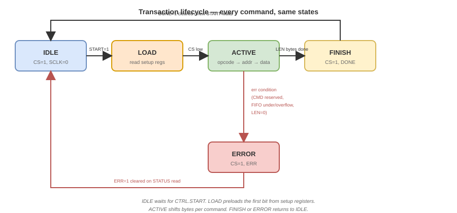

*Figure 2 — Transaction lifecycle. `IDLE` waits for a write to `CTRL`
with `START=1`. `LOAD` reads setup registers and preloads the first bit.
`ACTIVE` shifts opcode, address, dummy and data bytes according to the
command. `FINISH` deasserts `CS`, asserts `DONE` (or `ERR`), and returns
to `IDLE`.*

The per-command phases inside `ACTIVE` are documented in
[Section 6](#6-flash-command-set). The FSM here is generic; the
phase counter and the direction of each byte are driven by the `CMD`
field.

### 6. Error handling

The RTL sets `STATUS.ERR` (and asserts `DONE` so firmware can proceed)
when one of the following occurs:

| Condition | How to detect | Recovery |
|---|---|---|
| Reserved `CMD` value (`11`–`15`) | `STATUS.ERR=1` immediately | Firmware bug; fix the `CTRL` write |
| `START` while `STATUS.BUSY=1` | Second `START` ignored, no error | Firmware bug; poll `BUSY` before start |
| Write to `DATA` when TX FIFO full | `STATUS.ERR=1` | Firmware bug; check `LEN` vs FIFO depth |
| Read from `DATA` when RX FIFO empty | `STATUS.ERR=1`, read returns `0x00000000` | Firmware bug; check `LEN` vs available bytes |
| `LEN=0` for a data command | Treated as `256` for `PAGE_PROGRAM`; treated as `ERR` for `READ`/`FAST_READ` | Firmware bug |

`ERR` is a **sticky** flag cleared only by a read of `STATUS`. This
allows firmware to distinguish "transaction finished" (`DONE=1`,
`ERR=0`) from "transaction aborted" (`DONE=1`, `ERR=1`).

The RTL **does not** detect Flash-level errors such as "Flash did not
respond to WIP polling". That is a firmware responsibility, using the
`WIP` mirror in `STATUS`.

### 7. Software sequences

The three sequence examples below are the canonical firmware patterns.
They are written in plain C, targeting a `volatile uint32_t *` base
pointer. Addresses are offsets from `0x420000`.

#### 7.1 Read N bytes

```c
// 1. Configure the address
mmio_write32(BASE + 0x08, addr & 0x00FFFFFF);

// 2. Configure the length
mmio_write32(BASE + 0x10, len);

// 3. Start READ (CMD = 0)
mmio_write32(BASE + 0x00, (0u << 1) | 1u);

// 4. Wait for completion
while (mmio_read32(BASE + 0x04) & 1u) { /* poll BUSY */ }

// 5. Check for errors
uint32_t st = mmio_read32(BASE + 0x04);  // clears DONE/ERR
if (st & (1u << 2)) return -EIO;          // ERR
if (!(st & (1u << 1))) return -EIO;       // DONE not set

// 6. Read LEN bytes from DATA
for (uint32_t i = 0; i < len; i++)
    buf[i] = (uint8_t)(mmio_read32(BASE + 0x0C) & 0xFF);
```

#### 7.2 Program a page

```c
// 1. WREN (CMD = 2)
mmio_write32(BASE + 0x00, (2u << 1) | 1u);
while (mmio_read32(BASE + 0x04) & 1u) {}
if (mmio_read32(BASE + 0x04) & (1u << 2)) return -EIO;

// 2. Address and length
mmio_write32(BASE + 0x08, addr & 0x00FFFFFF);
mmio_write32(BASE + 0x10, len);   // 1..256

// 3. Push data into TX FIFO
for (uint32_t i = 0; i < len; i++)
    mmio_write32(BASE + 0x0C, buf[i] & 0xFF);

// 4. Start PAGE_PROGRAM (CMD = 7)
mmio_write32(BASE + 0x00, (7u << 1) | 1u);
while (mmio_read32(BASE + 0x04) & 1u) {}
if (mmio_read32(BASE + 0x04) & (1u << 2)) return -EIO;

// 5. Poll WIP via RDSR1 until the Flash finishes
while (1) {
    mmio_write32(BASE + 0x00, (4u << 1) | 1u);   // RDSR1
    while (mmio_read32(BASE + 0x04) & 1u) {}
    uint32_t st = mmio_read32(BASE + 0x04);
    if (st & (1u << 2)) return -EIO;
    if (!(st & (1u << 3))) break;                 // WIP clear
}
```

#### 7.3 Erase a sector

```c
// 1. WREN
mmio_write32(BASE + 0x00, (2u << 1) | 1u);
while (mmio_read32(BASE + 0x04) & 1u) {}

// 2. Address (only A[23:12] matter)
mmio_write32(BASE + 0x08, addr & 0x00FFF000);

// 3. Start SECTOR_ERASE (CMD = 8)
mmio_write32(BASE + 0x00, (8u << 1) | 1u);
while (mmio_read32(BASE + 0x04) & 1u) {}

// 4. Poll WIP (up to 400 ms for sector erase)
while (1) {
    mmio_write32(BASE + 0x00, (4u << 1) | 1u);
    while (mmio_read32(BASE + 0x04) & 1u) {}
    uint32_t st = mmio_read32(BASE + 0x04);
    if (!(st & (1u << 3))) break;
}
```

### 8. Driver skeleton

A minimal driver header follows. It is a suggested starting point for
the firmware team (group K); it is not part of the specification
itself.

```c
#ifndef SPI_FLASH_H
#define SPI_FLASH_H

#include <stdint.h>

#define SPI_FLASH_BASE  0x00420000u

#define REG_CTRL        0x00u
#define REG_STATUS      0x04u
#define REG_ADDR        0x08u
#define REG_DATA        0x0Cu
#define REG_LEN         0x10u
#define REG_CFG         0x14u

#define CMD_READ        0u
#define CMD_FAST_READ   1u
#define CMD_WREN        2u
#define CMD_WRDI        3u
#define CMD_RDSR1       4u
#define CMD_RDSR2       5u
#define CMD_WRSR        6u
#define CMD_PAGE_PROG   7u
#define CMD_SECTOR_ER   8u
#define CMD_BLOCK_ER    9u
#define CMD_CHIP_ER     10u

#define STATUS_BUSY     (1u << 0)
#define STATUS_DONE     (1u << 1)
#define STATUS_ERR      (1u << 2)
#define STATUS_WIP      (1u << 3)
#define STATUS_WEL      (1u << 4)

int     spi_flash_init(uint8_t clk_div);
int     spi_flash_read(uint32_t addr, uint8_t *buf, uint32_t len);
int     spi_flash_write(uint32_t addr, const uint8_t *buf, uint32_t len);
int     spi_flash_erase_sector(uint32_t addr);
int     spi_flash_erase_block(uint32_t addr);
int     spi_flash_erase_chip(void);
int     spi_flash_wait_wip(uint32_t timeout_ms);

#endif
```

### 9. Stability and update policy

This section is the contract between RTL and firmware. Any of the
following changes is considered **breaking** and requires coordination:

- Adding, removing, or renaming a register.
- Changing the offset of an existing register.
- Adding or removing a bit in `CTRL`, `STATUS`, `ADDR`, `LEN`, `CFG`.
- Changing the encoding of `CMD`.
- Changing the clear-on-read behavior of `DONE`/`ERR`.

When a breaking change is necessary:

1. Update this section first.
2. Update [Section 7](#7-controller-requirements) (Section 5 traceability)
   so the RF-to-CSR mapping stays accurate.
3. Notify group K (firmware) and the integration team before the RTL
   change is merged.

Non-breaking changes (adding a reserved bit, changing the FIFO depth
within the documented range, changing the default `CLK_DIV` value) do
not require coordination and can be made in a normal PR.

### 10. References

- [Section 7](#7-controller-requirements) — the RFs that this section
  implements.
- [Section 6](#6-flash-command-set) — per-command phases that the FSM in
  Section 5 must sequence.
- [Section 4](#4-target-flash-device) — device timing, used to size the
  polling timeout.
- [Section 5](#5-spi-protocol) — Mode 0 timing that the `CFG` register
  configures.
- Winbond W25Q128JV datasheet, §7 (Status Registers) and §8
  (Instructions).

---

## 9. Operation Flow

### 1. Purpose

Previous sections described individual commands
([Section 6](#6-flash-command-set)) and the register interface
([Section 8](#8-csr-interface-specification)). This section describes the
**sequences** — how firmware and RTL cooperate across more than one
transaction to accomplish a user-level operation: reading bytes, writing
a page, erasing a sector.

Each sequence is presented as:

1. **A flowchart** (original SVG) showing every step, color-coded by who
   performs it (firmware, RTL, or the Flash device).
2. **Prose** explaining the intent behind each group of steps.
3. **A reference** to the CSR registers and commands involved.

The three sequences covered are the only ones the KUBIX firmware needs.
Everything else is a variation (READ vs FAST_READ, SECTOR_ERASE vs
BLOCK_ERASE vs CHIP_ERASE, WRSR being a degenerate WRITE).

### 2. Where this fits

```
Specification documents (what)      ──►  This section (how, in sequence)
flash_memory.md         (device)         operation_flow.md
spi_protocol.md         (wire)
flash_commands.md       (per command)
csr_interface.md        (registers)
```

Downstream, `docs/02_architecture.md` will use these sequences as the
input for the RTL FSM design.

**Color convention in the flowcharts:**

- Blue box — firmware (`mmio_*` calls)
- Green box — RTL (controller internal actions)
- Red box — Flash device (actions taken by the slave)
- Yellow diamond — decision

### 3. READ operation

Reading bytes from the Flash is a single transaction followed by a
short read-out of the RX FIFO. No polling of `WIP` is required because
reads do not modify memory.

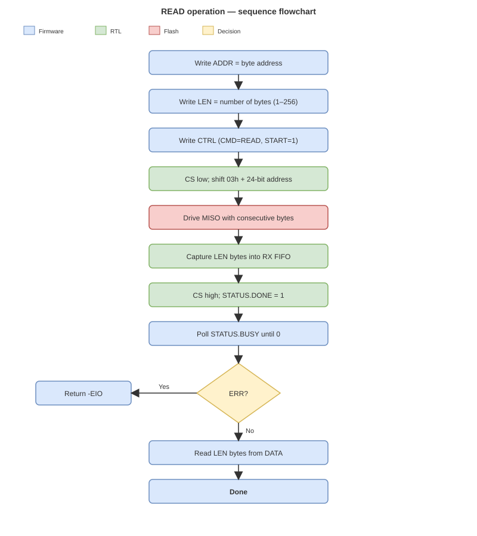

*Figure 1 — READ sequence. Firmware configures the address and length,
starts the transaction, waits for `BUSY` to clear, checks `ERR`, and
drains the RX FIFO through the `DATA` register.*

The sequence in prose:

1. **Configure.** Firmware writes `ADDR` (24 bits) and `LEN` (number of
   bytes). Both must be written **before** `CTRL`.
2. **Start.** Firmware writes `CTRL` with `CMD = READ` (`0`) and
   `START = 1`. The RTL immediately begins.
3. **RTL transaction.** The RTL asserts `CS` low, shifts the opcode
   `03h`, shifts the 24-bit address, then captures `LEN` bytes from
   `MISO` into the RX FIFO. It deasserts `CS` and sets `DONE`.
4. **Wait.** Firmware polls `STATUS.BUSY` until it clears. Because the
   FIFO is small, the RTL only clears `BUSY` when all `LEN` bytes are
   already in the FIFO.
5. **Check.** Firmware reads `STATUS` to check `ERR` (which clears both
   `DONE` and `ERR`). If `ERR = 1`, return an I/O error.
6. **Drain.** Firmware reads `DATA` `LEN` times, storing each returned
   byte (bits `7:0`) into the destination buffer.

**CSR registers used:** `ADDR`, `LEN`, `CTRL`, `STATUS`, `DATA`.
**Commands used:** READ (`03h`).
**Datasheet reference:** §8.2.6, Figure 14.

### 4. WRITE operation

Writing bytes requires **three** transactions: a `WREN`, a
`PAGE_PROGRAM`, and a polling loop of `RDSR1` until the Flash's internal
programming finishes.

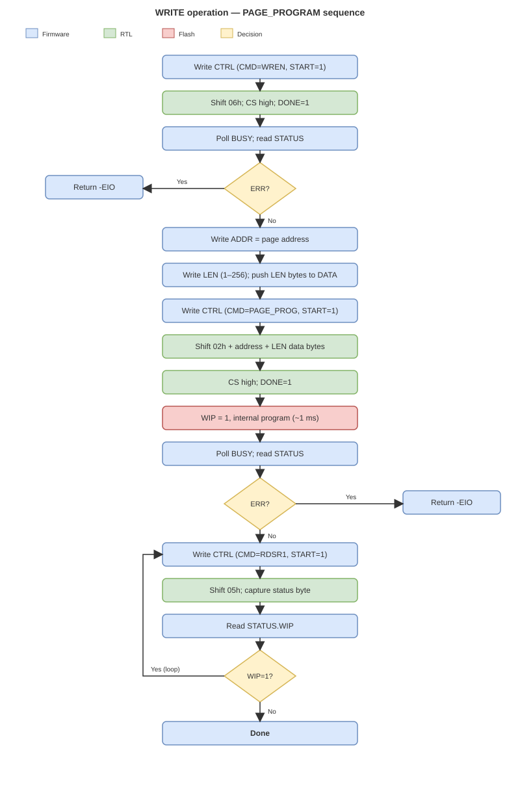

*Figure 2 — WRITE sequence (PAGE_PROGRAM). A `WREN` enables writing;
`PAGE_PROGRAM` sends the data; `RDSR1` polling waits until the Flash
clears `WIP`.*

The sequence in prose:

1. **Enable.** Firmware sends `WREN` (`CMD = 2`). The RTL shifts `06h`,
   deasserts `CS`, and sets `DONE`. Firmware polls `BUSY` and checks
   `ERR`. If `ERR = 1`, abort.
2. **Configure.** Firmware writes `ADDR` (page-aligned for best results),
   `LEN` (`1..256`), then pushes `LEN` bytes into the TX FIFO via `DATA`.
   If the FIFO depth is smaller than `LEN`, this loop must interleave with
   `BUSY` checks — the current implementation uses a FIFO of at least
   `256` bytes so the whole page can be pushed at once.
3. **Program.** Firmware writes `CTRL` with `CMD = PAGE_PROGRAM` (`7`)
   and `START = 1`. The RTL shifts `02h`, the 24-bit address, and the
   `LEN` data bytes from the TX FIFO. It deasserts `CS` and sets `DONE`.
4. **Flash internal.** The Flash starts programming its internal array.
   `WIP` becomes `1` inside the device. `DONE` in our `STATUS` is
   already set (the SPI transaction is over), but the operation is
   **not** complete yet.
5. **Poll.** Firmware enters the `RDSR1` loop: send `RDSR1` (`CMD = 4`),
   wait `BUSY` clear, read `STATUS.WIP`. If `WIP = 1`, loop again. When
   `WIP = 0`, the Flash has finished.
6. **Timeout.** Firmware applies a per-command timeout (see Section 8).
   If the loop exceeds it, return a timeout error.

**CSR registers used:** `CTRL`, `STATUS`, `ADDR`, `LEN`, `DATA`.
**Commands used:** WREN (`06h`), PAGE_PROGRAM (`02h`), RDSR1 (`05h`).
**Datasheet reference:** §8.2.1, §8.2.4, §8.2.13.

**Page-boundary note.** A `PAGE_PROGRAM` that crosses a 256-byte page
boundary wraps around to the start of the same page (see
[Section 4](#4-target-flash-device) §5). Firmware must split any write
that crosses a page boundary into two `PAGE_PROGRAM` transactions.

### 5. ERASE operation

Erasing requires **three** transactions, same shape as WRITE but with
no data phase: `WREN`, then the erase command (`SECTOR_ERASE`,
`BLOCK_ERASE` or `CHIP_ERASE`), then the `RDSR1` polling loop. The
polling timeout is much longer because erase takes milliseconds to
seconds.

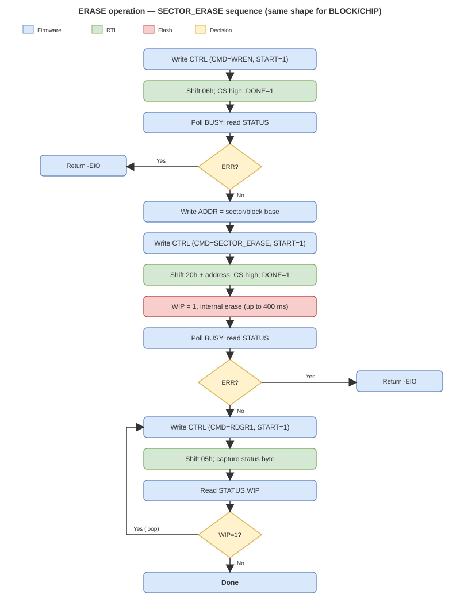

*Figure 3 — ERASE sequence (SECTOR_ERASE shown; BLOCK_ERASE and
CHIP_ERASE follow the same shape). A `WREN` enables erasing; the erase
command is issued; `RDSR1` polling waits for `WIP` to clear.*

The sequence in prose:

1. **Enable.** Same as WRITE — send `WREN`, wait, check `ERR`.
2. **Configure.** Firmware writes `ADDR` with the sector- or block-aligned
   address. `LEN` is not used by erase commands.
3. **Erase.** Firmware writes `CTRL` with `CMD = SECTOR_ERASE (8)` or
   `CMD = BLOCK_ERASE (9)` or `CMD = CHIP_ERASE (10)`, and `START = 1`.
   The RTL shifts the opcode and (for sector/block) the address, then
   deasserts `CS` and sets `DONE`.
4. **Flash internal.** The Flash begins the erase. `WIP = 1`.
5. **Poll.** Same `RDSR1` loop as in WRITE, but with a longer timeout
   (see Section 8). When `WIP = 0`, the erase has finished.

**CSR registers used:** `CTRL`, `STATUS`, `ADDR`.
**Commands used:** WREN (`06h`), SECTOR_ERASE (`20h`), BLOCK_ERASE
(`D8h`), CHIP_ERASE (`C7h`), RDSR1 (`05h`).
**Datasheet reference:** §8.2.1, §8.2.4, §8.2.15, §8.2.17, §8.2.18.

**Destructive operation warning.** `CHIP_ERASE` erases the entire memory
array. Firmware must never call it without explicit user confirmation.

### 6. The WIP polling strategy

Both WRITE and ERASE depend on polling the Flash's internal `WIP` bit
via `RDSR1`. The reason is architectural: the controller has no
back-channel from the Flash that says "I'm done". The only way to know
is to read `STATUS` and look at `WIP`.

**Why not poll at the RTL level?** Because it would tie the controller to
a specific timeout (which depends on which command was issued and on the
specific Flash part) and would make the RTL less reusable. Polling in
firmware keeps the RTL generic and lets the firmware tune its own
timeout, retry policy, and error handling.

**Why not use an interrupt?** Because the CSR does not expose one
(see [Section 7](#7-controller-requirements) §7 — interrupts are out of
scope). Firmware polls.

**Polling loop shape (in C):**

```c
do {
    start_cmd(CMD_RDSR1);
    wait_busy();
    st = read_status();      // clears DONE/ERR
    if (st & STATUS_ERR) return -EIO;
} while (st & STATUS_WIP);
```

**Polling interval.** The loop as written is a tight loop with no delay.
At a 10 MHz `SCLK`, a single `RDSR1` transaction takes 16 clocks
(~1.6 µs). A tight loop with no delay hits the Flash with a new status
read every ~2 µs. This is well within the datasheet's recommendation
(status reads are allowed at any time, even during an erase) but wastes
CPU cycles and power. If needed, firmware can add a short delay between
iterations; the controller does not require it.

**Give the Flash a head start.** Immediately after `DONE` for the
program/erase command, the Flash has just received the last byte and
has not yet asserted `WIP = 1` internally. The first `RDSR1` should be
issued after a short delay (a few hundred microseconds) to avoid
reading `WIP = 0` before the Flash has started. The datasheet states
that `WIP` goes high within ~200 ns of `CS` rising, so a **1 µs** delay
is sufficient. Firmware should not skip this delay.

### 7. Error paths

The three sequences above share the same error-recovery policy:

- **RTL-detected errors** (`STATUS.ERR = 1`): caused by firmware bug
  (reserved `CMD`, `LEN=0` for a data command, FIFO under/overflow). Fix
  the caller, do not retry.
- **Flash-side errors** (`WIP` stuck at `1` beyond the timeout): the Flash
  is unresponsive or the erase/program has failed. **Retry once**, then
  return error. The controller cannot distinguish "Flash is dead" from
  "Flash is just slow" — the timeout is what makes the distinction.
- **Timeouts** (Section 8): return `-ETIMEDOUT`. Never retry a timeout
  more than once; a hung Flash will hang the whole game.

The controller itself never retries. It performs exactly one transaction
per `CTRL.START`. All retry logic lives in firmware.

### 8. Timing budget

Firmware must size its timeouts based on the reference device's worst-case
timings from [Section 4](#4-target-flash-device) §7:

| Operation | Typical | Max | Recommended firmware timeout |
|---|---|---|---|
| PAGE_PROGRAM | 0.7 ms | 3 ms | 10 ms |
| SECTOR_ERASE (4 KB) | 45 ms | 400 ms | 1 s |
| BLOCK_ERASE (64 KB) | 150 ms | 2000 ms | 5 s |
| CHIP_ERASE | 20 s | 100 s | 120 s |

The controller does not enforce these timeouts. They are the firmware's
responsibility because only firmware knows which command it issued and
how long it can afford to wait.

**Bring-up recommendation.** Start with the maximum timeout values and
reduce them as the system is validated. During early bring-up it is
better to wait too long than to abort a correct operation.

### 9. References

- [Section 6](#6-flash-command-set) — per-command frames.
- [Section 8](#8-csr-interface-specification) — registers used by every
  step.
- [Section 4](#4-target-flash-device) §7 — timing used to size timeouts.
- [Section 7](#7-controller-requirements) — RFs that these sequences
  satisfy (RF-11 to RF-21).
- Winbond W25Q128JV datasheet, §8.2.4 (`RDSR1`), §8.2.13
  (`PAGE_PROGRAM`), §8.2.15–§8.2.18 (`SECTOR`/`BLOCK`/`CHIP_ERASE`).

---

## 10. Repository Structure

Sections 4 through 9 above correspond, one-to-one, to the six documents
of the specification chapter (`docs/01_specification/`). Later chapters
are maintained as separate documents under `docs/`:

| Stage | Purpose |
|---|---|
| [01 — Specification](docs/01_specification/README.md) | Define what the peripheral must do (Sections 4–9 of this README) |
| [02 — Architecture](docs/02_architecture.md) | Define how the required functionality is decomposed |
| [03 — Design](docs/03_design.md) | Transform the architecture into ASM, FSM, datapath and RTL |
| [04 — Verification](docs/04_verification.md) | Define and demonstrate how the design is verified |
| [05 — Integration](docs/05_integration.md) | Integrate the peripheral into the SoC and validate it on hardware |

Additional repository directories contain the implementation
artifacts:

| Directory | Contents |
|---|---|
| `rtl/` | Synthesizable RTL and RTL testbenches (`Makefile`, `waves/`) |
| `firmware/` | C driver (`driver/`), tests (`tests/`) and examples (`examples/`) |
| `diagrams/` | Own engineering diagrams (`architecture/`, `design/`, `protocol/`) |
| `references/spi_flash/` | Datasheet extracts (not own diagrams) — READ/WRITE/FAST_READ/RDSR waveforms |
| `planificacion/` | Project planning and task tracking |
| `docs/` | Book-style specification chapters 01–05 |

### Diagram index

All diagrams are original SVG, kept in the shared `diagrams/` tree so
they can also be opened in draw.io.

| Figure | File | Used by |
|---|---|---|
| Memory hierarchy | `diagrams/protocol/memory_hierarchy.svg` | Section 4 §4 |
| Address decomposition | `diagrams/protocol/address_decomposition.svg` | Section 4 §5 |
| FPGA ↔ Flash connection | `diagrams/protocol/connection_fpga_flash.svg` | Section 5 §8 |
| SPI Mode 0 timing | `diagrams/protocol/spi_mode0_timing.svg` | Section 5 §6 |
| WREN waveform | `diagrams/protocol/waveform_wren.svg` | Section 6 §3.1 |
| WRDI waveform | `diagrams/protocol/waveform_wrdi.svg` | Section 6 §3.2 |
| RDSR1 waveform | `diagrams/protocol/waveform_rdsr1.svg` | Section 6 §3.3 |
| RDSR2 waveform | `diagrams/protocol/waveform_rdsr2.svg` | Section 6 §3.4 |
| WRSR waveform | `diagrams/protocol/waveform_wrsr.svg` | Section 6 §3.5 |
| READ waveform | `diagrams/protocol/waveform_read.svg` | Section 6 §4.1 |
| FAST_READ waveform | `diagrams/protocol/waveform_fast_read.svg` | Section 6 §4.2 |
| PAGE_PROGRAM waveform | `diagrams/protocol/waveform_page_program.svg` | Section 6 §5.1 |
| SECTOR_ERASE waveform | `diagrams/protocol/waveform_sector_erase.svg` | Section 6 §5.2 |
| BLOCK_ERASE waveform | `diagrams/protocol/waveform_block_erase.svg` | Section 6 §5.3 |
| CHIP_ERASE waveform | `diagrams/protocol/waveform_chip_erase.svg` | Section 6 §5.4 |
| System context | `diagrams/architecture/system_context.svg` | Section 7 §2 |
| Register map | `diagrams/design/csr_map.svg` | Section 8 §2 |
| Transaction lifecycle FSM | `diagrams/design/csr_txn_fsm.svg` | Section 8 §5 |
| READ flow | `diagrams/design/flow_read.svg` | Section 9 §3 |
| WRITE flow | `diagrams/design/flow_write.svg` | Section 9 §4 |
| ERASE flow | `diagrams/design/flow_erase.svg` | Section 9 §5 |

---

## 11. Planning & Tracking

| Item | Link |
|---|---|
| GitHub Organization | [KUBIX2026](https://github.com/KUBIX2026) |
| Team repository | [spi_flash_ctrl](https://github.com/KUBIX2026/spi_flash_ctrl) |
| Team planning & conventions | [`planificacion/README.md`](planificacion/README.md) |
| Issue template (shared repo) | [`tarea.yml`](https://github.com/cicamargoba/digital_UN/tree/main/template/.github/ISSUE_TEMPLATE) |
| Evaluation rubric | [`rubrica_evaluacion_proyecto.md`](https://github.com/cicamargoba/digital_UN/blob/main/rubrica_evaluacion_proyecto.md) |

---

## 12. Development Status

### 12.1 Stage status

| Stage | Status | Target date |
|---|---|---|
| Requirements | ✅ Complete | 2026-10-XX |
| SPI Flash specification | ✅ Complete | 2026-10-XX |
| CSR specification | ✅ Complete | 2026-10-XX |
| Architecture | ⏳ Pending | 2026-11-XX |
| ASM | ⏳ Pending | 2026-11-XX |
| RTL | ⏳ Pending | 2026-11-XX |
| Verification | ⏳ Pending | 2026-11-XX |
| Firmware | ⏳ Pending | 2026-11-XX |
| SoC integration | ⏳ Pending | 2026-12-XX |
| FPGA validation | ⏳ Pending | 2026-12-XX |

### 12.2 Checkpoint status

The specification chapter (Sections 4–9) satisfies **Checkpoint 1** of
the course PBL:

- Flowchart of operation: ✅ (Section 9 §3–§5)
- CSR specification: ✅ (Section 8)
- Requirements: ✅ (Section 7)
- Per-command frames and waveforms: ✅ (Section 6)
- Traceability to verification: partially specified — the mapping from
  RF to test lives in [Section 7](#7-controller-requirements) §5 and
  will be filled with concrete test names in `docs/04_verification.md`.

### 12.3 What is *not* in this README

- Architecture (block decomposition, FSM details) — see
  `docs/02_architecture.md`.
- RTL and synthesis — see `docs/03_design.md`.
- Testbenches and simulation evidence — see `docs/04_verification.md`.
- SoC integration and hardware validation — see `docs/05_integration.md`.

---

*Last updated: 2026-10-XX*