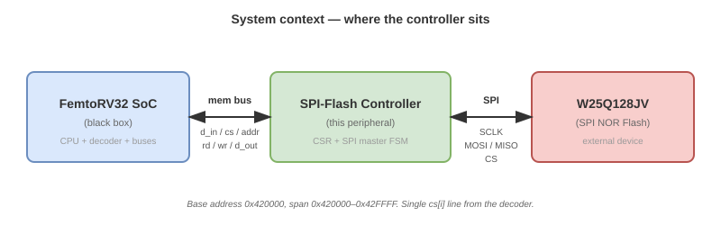

# Controller Requirements

[← Back to Specification index](README.md) · [← Back to project README](../../README.md)

## Contents

1. [Purpose](#1-purpose)
2. [System context](#2-system-context)
3. [Functional requirements](#3-functional-requirements)
4. [Non-functional requirements](#4-non-functional-requirements)
5. [Traceability matrix](#5-traceability-matrix)
6. [Acceptance criteria](#6-acceptance-criteria)
7. [Out-of-scope items](#7-out-of-scope-items)
8. [References](#8-references)

---

## 1. Purpose

This document defines **what** the SPI-Flash Controller must do. It sits
between the memory description ([`flash_memory.md`](flash_memory.md)), the
protocol ([`spi_protocol.md`](spi_protocol.md)) and the command set
([`flash_commands.md`](flash_commands.md)) on one side, and the architecture
([`../02_architecture.md`](../02_architecture.md)) and RTL on the other.

Each requirement has a unique identifier (`RF-NN` for functional,
`RNF-NN` for non-functional) and is traceable to:

- the command or feature it comes from (left column of the traceability
  matrix in Section 5),
- the CSR register that implements it ([`csr_interface.md`](csr_interface.md)),
- the verification test that proves it ([`../04_verification.md`](../04_verification.md)).

A requirement that cannot be traced to a test is an unverified requirement
and is not considered met.

## 2. System context

The controller is a memory-mapped peripheral attached to the FemtoRV32
SoC data bus. On one side it exposes the standard course port contract
(`d_in`, `cs`, `addr`, `rd`, `wr`, `d_out`); on the other side it drives
the four SPI wires (`SCLK`, `MOSI`, `MISO`, `CS`) to the external Flash.

*Figure 1 — System context. The controller bridges the FemtoRV32 SoC's
memory bus (`d_in`, `cs`, `addr`, `rd`, `wr`, `d_out`) on the left and
the external SPI NOR Flash (`SCLK`, `MOSI`, `MISO`, `CS`) on the right.
The controller is placed at base `0x420000` with a 64 KB window.*
The controller is located at base address `0x420000` and spans
`0x420000–0x42FFFF` (see the course memory map). It uses exactly one
`cs[i]` line from the address decoder; the index `i` is fixed by the
integration team.

## 3. Functional requirements

### 3.1 Bus and CSR interface

| ID | Requirement | Source |
|---|---|---|
| **RF-01** | The controller shall expose the course peripheral port contract: `input [31:0] d_in`, `input cs`, `input [N-1:0] addr`, `input rd`, `input wr`, `output reg [31:0] d_out`. | PBL spec |
| **RF-02** | The controller shall respond only when `cs` is asserted, and shall drive `d_out` to zero (or high-Z, per course convention) otherwise. | PBL spec |
| **RF-03** | The controller shall decode word-aligned offsets within its 64 KB window: `0x00` CTRL, `0x04` STATUS, `0x08` ADDR, `0x0C` DATA, `0x10` LEN, `0x14` CFG. | `csr_interface.md` |
| **RF-04** | The controller shall accept write access to CTRL, ADDR, DATA, LEN and CFG, and read access to STATUS and DATA. | `csr_interface.md` |
| **RF-05** | `ADDR` shall hold a 24-bit Flash byte address; bits `[31:24]` shall be ignored. | `flash_memory.md` §5 |
| **RF-06** | `LEN` shall hold a transfer length from 1 to 256 bytes; a write of 0 or >256 shall be clamped or rejected (implementation-defined). | `flash_memory.md` §4 |

### 3.2 SPI master

| ID | Requirement | Source |
|---|---|---|
| **RF-07** | The controller shall generate `SCLK` in SPI Mode 0 (`CPOL=0`, `CPHA=0`): idle low, data sampled on rising edge, data changed on falling edge. | `spi_protocol.md` §6 |
| **RF-08** | The controller shall generate `SCLK` with a programmable divider `CLK_DIV` such that `f_SCLK = f_sys / (2 · (CLK_DIV + 1))`. | `spi_protocol.md` §9 |
| **RF-09** | The controller shall drive `CS` low at the start of every transaction and high at the end, and shall enforce a byte-boundary termination for WREN, WRSR, PAGE_PROGRAM, SECTOR_ERASE, BLOCK_ERASE and CHIP_ERASE. | `flash_commands.md` §6 |
| **RF-10** | The controller shall shift bytes MSB-first on `MOSI` and shall sample `MISO` on the rising edge of `SCLK`. | `flash_commands.md` §2 |

### 3.3 Command execution

| ID | Requirement | Source |
|---|---|---|
| **RF-11** | The controller shall execute the **WREN (06h)** transaction: `CS` low, opcode `06h` on `MOSI`, `CS` high. `MISO` is not driven. | `flash_commands.md` §3.1 |
| **RF-12** | The controller shall execute the **WRDI (04h)** transaction: `CS` low, opcode `04h`, `CS` high. `MISO` is not driven. | `flash_commands.md` §3.2 |
| **RF-13** | The controller shall execute **RDSR1 (05h)** and capture the byte returned on `MISO` into the RX FIFO. | `flash_commands.md` §3.3 |
| **RF-14** | The controller shall execute **RDSR2 (35h)** and capture the byte returned on `MISO` into the RX FIFO. | `flash_commands.md` §3.4 |
| **RF-15** | The controller shall execute **WRSR (01h)**: `CS` low, opcode `01h`, one data byte from the TX FIFO on `MOSI`, `CS` high. `MISO` is not driven. | `flash_commands.md` §3.5 |
| **RF-16** | The controller shall execute **READ (03h)**: `CS` low, opcode `03h`, 24-bit address, then `LEN` data bytes received from `MISO` into the RX FIFO, `CS` high. | `flash_commands.md` §4.1 |
| **RF-17** | The controller shall execute **FAST_READ (0Bh)**: identical to READ plus one dummy byte (8 extra clocks) between the address and the first data byte. | `flash_commands.md` §4.2 |
| **RF-18** | The controller shall execute **PAGE_PROGRAM (02h)**: `CS` low, opcode `02h`, 24-bit address, `LEN` data bytes from the TX FIFO on `MOSI`, `CS` high. | `flash_commands.md` §5.1 |
| **RF-19** | The controller shall execute **SECTOR_ERASE (20h)**: `CS` low, opcode `20h`, 24-bit address, `CS` high. `MISO` is not driven. | `flash_commands.md` §5.2 |
| **RF-20** | The controller shall execute **BLOCK_ERASE (D8h)**: `CS` low, opcode `D8h`, 24-bit address, `CS` high. `MISO` is not driven. | `flash_commands.md` §5.3 |
| **RF-21** | The controller shall execute **CHIP_ERASE (C7h)**: `CS` low, opcode `C7h`, `CS` high. `MISO` is not driven. | `flash_commands.md` §5.4 |

### 3.4 Status reporting

| ID | Requirement | Source |
|---|---|---|
| **RF-22** | The controller shall set `STATUS.BUSY = 1` for the entire duration of a transaction (from `START` to the internal completion, including FIFO drain for reads). | `csr_interface.md` |
| **RF-23** | The controller shall set `STATUS.DONE = 1` when a transaction completes; `DONE` shall be cleared when STATUS is read. | `csr_interface.md` |
| **RF-24** | The controller shall set `STATUS.ERR = 1` if a transaction is aborted (FIFO underrun/overrun, or timeout configured in CFG). | `csr_interface.md` |
| **RF-25** | For each completed RDSR1 transaction, the controller shall mirror the returned status byte's bit 0 into `STATUS.WIP` and bit 1 into `STATUS.WEL`. | `csr_interface.md` |

### 3.5 Data flow

| ID | Requirement | Source |
|---|---|---|
| **RF-26** | The controller shall provide a TX FIFO into which firmware writes bytes through the `DATA` register for PAGE_PROGRAM and WRSR. | `csr_interface.md` |
| **RF-27** | The controller shall provide an RX FIFO from which firmware reads bytes through the `DATA` register for READ, FAST_READ, RDSR1 and RDSR2. | `csr_interface.md` |
| **RF-28** | Writing to `DATA` when the TX FIFO is full shall be ignored and shall set `STATUS.ERR`. | `csr_interface.md` |
| **RF-29** | Reading from `DATA` when the RX FIFO is empty shall return `0x00000000` and shall set `STATUS.ERR`. | `csr_interface.md` |
| **RF-30** | `LEN` shall bound the number of bytes read from the RX FIFO or written from the TX FIFO per transaction. | `csr_interface.md` |

## 4. Non-functional requirements

| ID | Requirement | Rationale |
|---|---|---|
| **RNF-01** | The design shall be fully synthesizable Verilog-2001 (no SystemVerilog constructs). | Course toolchain |
| **RNF-02** | `SCLK` shall not exceed 50 MHz for READ and 133 MHz for FAST_READ; the divider must allow both. | `flash_memory.md` §7 |
| **RNF-03** | The design shall use a single clock domain (`clk`) with an asynchronous active-high reset (`rst`). No internal generated clocks except `SCLK`, which is derived synchronously and used only as a SPI output. | PBL spec |
| **RNF-04** | The design shall be verified with `iverilog` and `gtkwave` using a self-checking testbench. | Course toolchain |
| **RNF-05** | The design shall not modify the FemtoRV32 core, the address decoder, or any other peripheral. | PBL spec |
| **RNF-06** | The CSR interface (`csr_interface.md`) shall be finalized before any RTL coding starts. | Method |
| **RNF-07** | The design shall not implement Dual or Quad SPI; only Standard SPI with `MOSI`, `MISO`, `SCLK`, `CS` is required. | `flash_commands.md` §7 |
| **RNF-08** | All I/O shall be synchronous to `clk`; no combinational paths longer than one register stage between `cs` and `d_out` are allowed. | Timing |
| **RNF-09** | The RTL shall include a per-command testbench that exercises at least one full transaction for each of the 11 commands. | Verification |
| **RNF-10** | The RTL shall be structured as at least two modules: `spi_master` (bit-level shifter) and `spi_flash_ctrl` (CSR + FSM). | Architecture |
| **RNF-11** | The controller shall not exceed 500 LUTs on the target FPGA (to be confirmed after synthesis). | Budget |
| **RNF-12** | The design shall reset to a state where `CS = 1`, `SCLK = 0`, `MOSI = 0` (idle). | Safety |

## 5. Traceability matrix

Each functional requirement traces back to a command or a CSR register and
forward to the verification test that proves it. The verification column
is filled in during `04_verification.md`; the cells that say "TBD" are
placeholders until that document is written.

### 5.1 Command traceability

| Requirement | Command | Datasheet figure | CSR register(s) used |
|---|---|---|---|
| RF-11 | WREN (06h) | §8.2.1, Fig. 5 | CTRL (`CMD=WREN`), STATUS (`DONE`) |
| RF-12 | WRDI (04h) | §8.2.3, Fig. 7 | CTRL, STATUS |
| RF-13 | RDSR1 (05h) | §8.2.4, Fig. 8a | CTRL, DATA (RX), STATUS (`WIP`, `WEL`, `DONE`) |
| RF-14 | RDSR2 (35h) | §8.2.4, Fig. 8a | CTRL, DATA (RX), STATUS |
| RF-15 | WRSR (01h) | §8.2.5, Fig. 9a | CTRL, DATA (TX), LEN=1, STATUS |
| RF-16 | READ (03h) | §8.2.6, Fig. 14 | CTRL, ADDR, LEN, DATA (RX), STATUS |
| RF-17 | FAST_READ (0Bh) | §8.2.7, Fig. 16a | CTRL, ADDR, LEN, DATA (RX), STATUS |
| RF-18 | PAGE_PROGRAM (02h) | §8.2.13, Fig. 29a | CTRL, ADDR, LEN, DATA (TX), STATUS |
| RF-19 | SECTOR_ERASE (20h) | §8.2.15, Fig. 31a | CTRL, ADDR, STATUS |
| RF-20 | BLOCK_ERASE (D8h) | §8.2.17, Fig. 33a | CTRL, ADDR, STATUS |
| RF-21 | CHIP_ERASE (C7h) | §8.2.18, Fig. 34 | CTRL, STATUS |

### 5.2 Interface traceability

| Requirement | CSR register | Spec section |
|---|---|---|
| RF-01, RF-02 | (port contract) | PBL spec |
| RF-03 | All registers | `csr_interface.md` §2 |
| RF-04 | All registers | `csr_interface.md` §2 |
| RF-05 | ADDR | `csr_interface.md` §2.3 |
| RF-06 | LEN | `csr_interface.md` §2.5 |
| RF-07, RF-08 | CFG | `csr_interface.md` §2.6 |
| RF-22 … RF-25 | STATUS | `csr_interface.md` §2.2 |
| RF-26 … RF-30 | DATA, LEN | `csr_interface.md` §2.4, §2.5 |

## 6. Acceptance criteria

The specification is accepted when **all** of the following hold:

### 6.1 Document-level acceptance

- [ ] Every requirement in Sections 3 and 4 has a unique identifier.
- [ ] Every functional requirement appears in the traceability matrix
      (Section 5.1 or 5.2).
- [ ] Every command in `flash_commands.md` has at least one RF that covers
      it (RF-11 through RF-21).
- [ ] Every CSR register in `csr_interface.md` appears in Section 5.2.
- [ ] No functional requirement contradicts `flash_memory.md` or
      `spi_protocol.md`.

### 6.2 Implementation-level acceptance (for later checkpoints)

These are the criteria the RTL must eventually satisfy; they are listed
here so that the verification plan in `04_verification.md` can be written
against them.

- [ ] A testbench exercises each of the 11 commands at least once.
- [ ] A testbench exercises the FIFO full and empty error paths
      (RF-28, RF-29).
- [ ] A testbench exercises the `DONE` clear-on-read behavior (RF-23).
- [ ] A testbench exercises `CLK_DIV` at minimum and maximum values
      (RF-08).
- [ ] Synthesis passes on the target FPGA without warnings (RNF-01).
- [ ] `CS`, `SCLK` and `MOSI` reset to their idle levels (RNF-12).

## 7. Out-of-scope items

The following are deliberately excluded from this version of the
requirements. They may be added in a later revision but are not part of
the current acceptance criteria.

| Item | Reason |
|---|---|
| Dual/Quad SPI modes | Requires IO1/IO2/IO3 wiring and QE configuration |
| Write protection bits (BP, TB, SEC, CMP) | Not used by KUBIX |
| Block/Sector locks | Not used |
| Erase/Program Suspend and Resume | Polling model is sufficient |
| Power-down mode | Device stays powered |
| JEDEC ID check at startup | Optional; can be added in a later revision |
| DMA or burst transfer from the SoC side | The CSRs are enough for firmware-driven transfers |
| Interrupt generation (e.g., IRQ on DONE) | Polling model only |

## 8. References

- Course PBL specification (top-level).
- [`flash_memory.md`](flash_memory.md) — target device.
- [`spi_protocol.md`](spi_protocol.md) — wire protocol.
- [`flash_commands.md`](flash_commands.md) — per-command frames.
- [`csr_interface.md`](csr_interface.md) — memory-mapped register map
  (to be written in Step 5).
- Winbond W25Q128JV datasheet, revision E.

---

*Last updated: 2026-10-XX*
*Authors: @camahechag-bars, @jcanizalez16, @edfrancos*