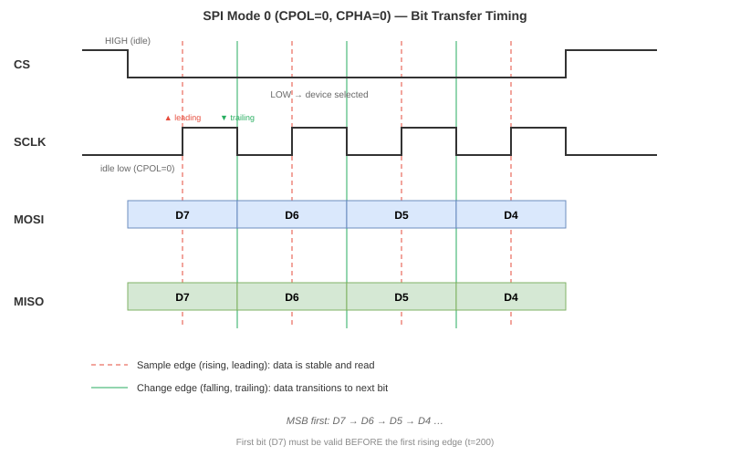
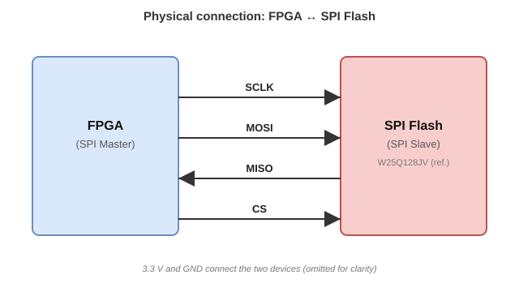

# SPI Protocol

[← Back to Specification index](README.md) · [← Back to project README](../../README.md)

## Contents

1. [Why this document exists](#1-why-this-document-exists)
2. [What SPI is](#2-what-spi-is)
3. [The four bus signals](#3-the-four-bus-signals)
4. [Key characteristics](#4-key-characteristics)
5. [SPI modes: CPOL and CPHA](#5-spi-modes-cpol-and-cpha)
6. [Mode 0 in detail](#6-mode-0-in-detail)
7. [The transaction template](#7-the-transaction-template)
8. [Physical connection](#8-physical-connection)
9. [Design intuition: frequency vs. correctness](#9-design-intuition-frequency-vs-correctness)
10. [What the controller must implement](#10-what-the-controller-must-implement)

---

## 1. Why this document exists

Before the controller can talk to the Flash, we need to agree on *how* the
conversation happens: which wires carry what, who drives them, and when
a bit is considered valid. This document defines the **SPI protocol** as
applied in this project. It answers *how* two devices exchange bits; it
does **not** answer *what* each command means (that is in
[`flash_commands.md`](flash_commands.md)) or *how* the chip is organized
internally (that is in [`flash_memory.md`](flash_memory.md)).

## 2. What SPI is

**SPI** (**Serial Peripheral Interface**) is a **synchronous, serial,
full-duplex** communication protocol. One device acts as **master** (in our
case, the FPGA) and controls one or more **slaves** (in our case, the Flash
memory). The master generates the clock; the slave never does. The master
initiates every transaction; the slave only responds.

> **Why synchronous?** Because a dedicated clock line (`SCLK`) travels
> alongside the data. Both sides agree that a bit is valid *at a specific
> clock edge*, not after a fixed time. This removes the need for both
> sides to have matched internal oscillators, which is why SPI is simple
> and reliable at high frequencies.

## 3. The four bus signals

| Signal | Full name | Direction | Function |
|---|---|---|---|
| `SCLK` | Serial Clock | Master → Slave | Clock generated by the master. |
| `MOSI` | Master Out Slave In | Master → Slave | Data from master to slave. |
| `MISO` | Master In Slave Out | Slave → Master | Data from slave to master. |
| `CS` (or `SS`) | Chip Select / Slave Select | Master → Slave | Active low. Selects the slave. |

`SCLK`, `MOSI`, and `CS` are driven by the FPGA. `MISO` is driven by the
Flash. The Flash only drives `MISO` while `CS` is low; when `CS` is high,
the Flash releases `MISO` to high-impedance (Z) so other slaves could share
the bus.

## 4. Key characteristics

- **Synchronous.** Data is sampled on a specific clock edge. The choice
  of which edge (rising or falling) and the clock's idle level define the
  SPI mode (Section 5).
- **Full-duplex.** `MOSI` and `MISO` are independent wires; the master
  sends a bit on `MOSI` *at the same time* it receives a bit on `MISO`.
  Every clock cycle is a simultaneous transmit-and-receive.
- **Master-generated clock.** `SCLK` is produced by the FPGA. The Flash
  has no internal clock source for the bus.
- **Data stability rule.** When a bit is sampled, it must be stable. In
  practice this means *data changes on one clock edge and is sampled on
  the other*, giving a full half-cycle of settling time (Section 6).
- **Frequency is bounded by the slave.** The Flash datasheet defines a
  maximum `SCLK` frequency (50 MHz for `READ`, 133 MHz for `FAST_READ`).
  The controller must not exceed it (see timing table in
  [`flash_memory.md`](flash_memory.md#7-timing-parameters)).

## 5. SPI modes: CPOL and CPHA

Two parameters define the clock behavior:

- **CPOL** (Clock Polarity): the idle level of `SCLK`.
  - `CPOL = 0` → idle low.
  - `CPOL = 1` → idle high.
- **CPHA** (Clock Phase): which edge samples the data.
  - `CPHA = 0` → sample on the **leading** edge (first edge of each pulse).
  - `CPHA = 1` → sample on the **trailing** edge (second edge of each pulse).

This yields four modes:

| Mode | CPOL | CPHA | Idle level | Sample edge | Change edge |
|---|---|---|---|---|---|
| 0 | 0 | 0 | Low | Rising (leading) | Falling (trailing) |
| 1 | 0 | 1 | Low | Falling (trailing) | Rising (leading) |
| 2 | 1 | 0 | High | Falling (leading) | Rising (trailing) |
| 3 | 1 | 1 | High | Rising (trailing) | Falling (leading) |

Flash memories typically use **Mode 0** or **Mode 3**. This project uses
**Mode 0**. The reference device (W25Q128JV) supports both; the controller
selects Mode 0 because it is the simplest to describe and to verify.

## 6. Mode 0 in detail

In Mode 0, `SCLK` idles **low**. The first edge of each clock pulse is the
**rising edge**, and it is the edge where data is sampled (this is the
*leading edge*). The **falling edge** is the *trailing edge*, where the
data is allowed to change for the next bit.

The figure below shows four bits being transferred in Mode 0. The red
dashed lines mark the **sample points** (rising edges). The green solid
lines mark the **change points** (falling edges).

*Figure 1 — Mode 0 bit-transfer timing. On each rising edge the receiver
samples the current bit; on each falling edge the transmitter sets up the
next bit. The full half-cycle between edges guarantees that the data is
stable when it is sampled.*

Three observations that matter for the controller:

1. **First bit setup.** The first bit (`D7` in the figure) must be valid
   **before the first rising edge**. Since `CS` goes low at the start of
   the transaction, the master (and the slave, on `MISO`) has until the
   first rising edge to present the bit. In practice the controller
   preloads the first bit into the shift register as soon as `CS` falls.
2. **Last bit sampling.** The last bit is sampled on the last rising edge.
   After that, `CS` may go high; the falling edge that would normally
   change the data does not need to occur, because the transaction is
   ending.
3. **`CS` is the transaction delimiter.** While `CS` is low, the clock
   keeps shifting bits. When `CS` goes high, the transaction is over
   (subject to byte-boundary rules discussed in
   [`flash_commands.md`](flash_commands.md)).

> **Mode 3 is the mirrored version.** In Mode 3, `SCLK` idles high, the
> data changes on the falling edge, and it is sampled on the rising edge.
> The half-cycle stability rule is identical; only the levels are
> inverted. Because the reference device supports both, choosing Mode 0
> or Mode 3 is a controller decision, not a protocol requirement.

## 7. The transaction template

Every Flash command follows the same envelope, even though the interior
differs per command:

    CS low  →  [Opcode]  →  [Address]  →  [Dummy]  →  [Data]  →  CS high

- **Opcode** — 1 byte that selects the operation.
- **Address** — 3 bytes (24 bits, MSB first), only when the command needs it.
- **Dummy** — 0 or more bytes of padding, only for commands that need
  internal setup time (`FAST_READ` is the classic example).
- **Data** — bytes transmitted (`MOSI`) or received (`MISO`), depending on
  the command. Length is defined per command.

The controller’s job, at the protocol level, is to sequence these phases
correctly: assert `CS`, shift the opcode, optionally shift the address,
optionally insert dummy cycles, then shift data, then deassert `CS`. The
exact bytes for each phase are specified in
[`flash_commands.md`](flash_commands.md); the CSR that drives them is in
[`csr_interface.md`](csr_interface.md).

## 8. Physical connection

Four wires carry the protocol; two more provide power and ground. In
Standard SPI, only four of the Flash’s eight SOIC-8 pins are used for
data:

*Figure 2 — Physical connection between the FPGA (master) and the Flash
(slave). `MOSI`, `SCLK`, and `CS` are driven by the FPGA; `MISO` is driven
by the Flash. Power (3.3 V) and ground are shared. The `/WP` and `/HOLD`
pins of the Flash are tied high in this project to disable write-protect
and hold features.*

| FPGA signal | FPGA direction | Flash pin | Flash pin number |
|---|---|---|---|
| `SCLK` | Output | `CLK` | 6 |
| `MOSI` | Output | `DI` (IO0) | 5 |
| `MISO` | Input | `DO` (IO1) | 2 |
| `CS` | Output | `/CS` | 1 |

## 9. Design intuition: frequency vs. correctness

Unlike protocols that carry sampled signals (for example I2S, where the
sample rate must match exactly or the audio is distorted), **SPI
tolerates any clock frequency** as long as the maximum of the slave is
respected. The bits arrive at a different *rate*, but each bit is
correct regardless of how fast or slow the clock runs.

The implication for the controller is that **`SCLK` speed is a performance
parameter, not a correctness parameter**. Slower means a longer
transaction, but the same bytes. This is why the CSR exposes a
**`CLK_DIV` register** ([`csr_interface.md`](csr_interface.md)) that lets
firmware trade speed for safety margin during bring-up.

## 10. What the controller must implement

Pulling together everything above, the controller must:

1. Generate `SCLK` in Mode 0 with a programmable divider.
2. Drive `CS` low at the start of a transaction and high at the end,
   respecting the byte-boundary rule for writes.
3. Shift out `MOSI` bits and shift in `MISO` bits on the correct edges.
4. Sequence the phases according to the opcode being executed.
5. Expose the whole transaction through the CSR so firmware can request
   it and read its result.

The **`SCLK` frequency**, the **exact opcode sequences**, and the **CSR
layout** are the subject of the remaining documents in this chapter.
This document has established only the *vocabulary*: signals, modes,
and the transaction template.

---

*Last updated: 2026-10-XX*
*Authors: @camahechag-bars, @jcanizalez16, @edfrancos*